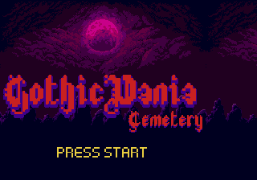
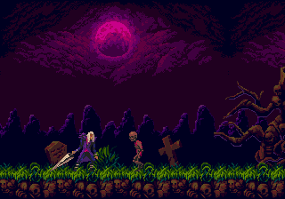
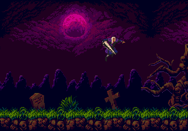
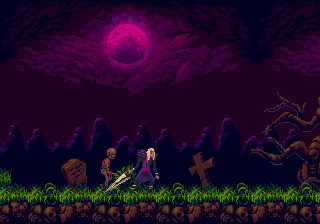

# Gothicvania: SNES → Mega Drive source port

The SNES Gothicvania homebrew (PVSnesLib, C) is rebuilt as a native SGDK game
instead of trying to interpret 65816 code on a 68000. The original level,
collision, hero/enemy art, animation frames, enemy AI and state machine are
preserved in the port; the SNES-specific renderer is translated to the Mega
Drive VDP.

## What is preserved

- 4800×224 graveyard level, built from the committed 600×28 8×8-tile data;
- the original 300×14 16×16 collision map (`0` empty, `1` solid, `2` one-way);
- hero: 21 frames (idle/run/jump/crouch/attack/hurt), 8.8 fixed-point physics,
  jump, sword attack, hurt knockback and 3 HP;
- skeletons, hell-gatos and ghosts with the original spawn table, rise/walk/
  float AI, contact damage and sword kills;
- pit respawn, level-end trigger and game-over/end states;
- title screen with the original logo/“Cemetery”/“PRESS START” art extracted
  from the SNES title screen, over the moon/mountain scene;
- `Baroque` and `Title` MIDI → YM2612 VGM music plus PCM jump/attack/hurt/
  kill/rise SFX.

## Renderer translation

| SNES | Mega Drive |
| --- | --- |
| BG0 ground + BG1 decorations (two 4bpp planes) | one pre-composited BG_A level (ground over decorations), streamed as 19 page `IMAGE` resources |
| BG2 2bpp mountains + HDMA sky gradient | one BG_B `bg.png` night scene (moon/clouds/mountains); sky gradient is baked into the art |
| 64×64 OBJs, 2 OBJ bands | 32×32 hardware sprites tiled in 2×2 or 4×2 groups; hero 128×64 uses 8 sprites |
| SNESMOD / IT music | SGDK XGM2 (MIDI → VGM) + XGM2 PCM SFX |
| HDMA colour math | not available; static backdrop/palette approximation |

The level uses a 64×32 plane with two 32×32 page slots (288 tiles each), so a
page is loaded off-screen before the camera reveals it. BG_B scrolls at
`camX * 7 / 100`; the level uses the original camera speed.

## Build

From the engine: **Game Build → SNES project → SNES → Mega Drive**. The
adapter is `ide/addons/retro_engine/snes_to_md_port.gd`; the generator is
`tools/gothicvania_md_port.py`.

Standalone:

```bash
python3 tools/gothicvania_md_port.py \
  /path/to/gothicvania /tmp/gothicvania_md --name gothicvania_md
cd /tmp/gothicvania_md
GDK=/path/to/sgdk make -j4
```

The generated ROM is `out/rom.bin` (512 KiB, SEGA header, 68000 SGDK).

## Verified

```text
source: snes-test-projects/snes-homebrew/gothicvania
ROM:    524,288 bytes, Mega Drive linear, SEGA header OK
build:  exit 0, 0 errors
preview: 1,254 frames; audio packets/frames flowing
```






## Jump/hurt fix

The port clamps the hero to the level bounds and uses a 16-bit, normalized
enemy-knockback direction.  A `s8` return corrupted by LTO had produced a huge
`vx` (`-22187`) that teleported the hero off-screen; 90 frames of hurt
invulnerability also let him escape a skeleton overlapping the level edge.

## Remaining differences

- The Mega Drive has two scrolling planes; the SNES version has three. The
  ground/deco layers are pre-composited and the sky gradient is baked into the
  parallax art, so the layers cannot scroll independently.
- The end/game-over screens use the SGDK font rather than the original SNES
  overlays (the title logo is the original art).
- Music is a MIDI → YM2612 transcription; it is not the SNESMOD/IT data played
  back sample-for-sample.
- This adapter is specific to Gothicvania's PVSnesLib C/asset layout. Other
  SNES binaries still need their own source-level adapter.
