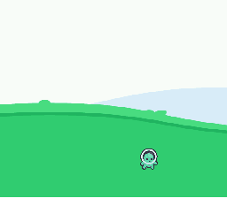
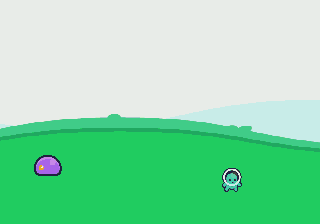

# Release test: user-built SNES + Mega Drive sidescroller

This is an end-to-end test done through the engine's project/template, native
import, audio and Game Build paths.

## Assets (downloaded from the web)

- player: `character_green_idle.png` from the Kenney Platformer Pack mirror
  `darkshahmeerpro/Platformer-Asstes`;
- enemy: `slime_normal_walk_a.png` from the same pack;
- background: `background_color_hills.png` from the same pack;
- music: `Enjoy-The-Silence.mid` from BitMidi (`bitmidi.com/uploads/43723.mid`).

The MIDI is converted to a compact IT soundbank for SNES and to YM2612 VGM for
Mega Drive.

## Workflow

1. Created `sidescroller_snes` and `sidescroller_md` with the New Project
   templates.
2. Imported Player, Enemy and a ground collision into each project with the
   Native scene importer.
3. Imported a 512x224 background with the background/stage importer.
4. Added the Enjoy the Silence MIDI to the project audio assets.
5. Built both with Game Build and ran them in the real libretro preview.

## Errors found and fixed in the app

1. **Indexed TileMapLayer backgrounds became white.** `_import_tilemap()` now
   converts the texture image to RGBA8 before blitting tiles into the stage
   atlas.
2. **Actors did not follow the camera.** The native runtime scrolled the BG but
   drew actors in world coordinates; they walked off-screen. `camera_x/y` is
   now subtracted from SNES OAM and MD sprite positions.
3. **Mega Drive camera scroll had the wrong sign.** The native MD runtime now
   uses `-cx` for `VDP_setHorizontalScroll`.
4. **SNES BGM was silent.** `spcFlush()` after `spcLoad()` discarded the loaded
   module. It is no longer emitted, and `spcSetModuleVolume(255)` is set before
   `spcPlay`.
5. The test uses a 512x224 world so it fits one 64x32 plane on both consoles;
   larger native stages still need page streaming.

## Results

```text
SNES ROM: 262,144 bytes, LoROM, checksum OK
MD ROM:   262,144 bytes, SEGA header OK
preview:  player moved right, stage scrolled, audio packets/frames active
SNES audio capture: peak 20,480 / RMS 5,482
MD audio capture:   peak 4,517 / RMS 840
```





