> Historical validation record from the original project layout. Migration
> checks are recorded separately in `docs/FORK_MIGRATION.md`.

# Validation report

Date: 2026-10-29  
Host: Linux x86_64, Intel Iris Xe, 37 GiB RAM, 12 threads  
Editor: Godot 4.7.2-stable + `retro_engine` module, custom build  
SDKs: PVSnesLib 4.6.0, SGDK 2.11  
Emulators detected: Mesen, bsnes, Snes9x (Flatpak), BlastEm, RetroArch

All tests ran on **copies** under `validation/projects/`. The original reference
trees were not edited by the importer or editor. Build outputs are produced by
the real `make`/SDK processes.

## 1. Module and editor startup

| Check | Result |
| --- | --- |
| Godot editor starts on Linux | PASS (`4.7.2.stable.custom_build`) |
| `RetroSDK.detect_all()` finds both SDKs | PASS |
| PVSnesLib probe | `4.6.0`, native Linux tools found, `ready=true` |
| SGDK probe | `SGDK 2.11`, `libmd.a` + `rescomp.jar`, Linux path detected |
| Editor plugin loads without parse/runtime errors | PASS (`SCRIPT ERROR` scan clean) |
| Retro workspace opens automatically | PASS |
| Auto-import configuration persisted | PASS (`user://retro_engine.cfg`) |

## 2. Import and conversion

| Project | Detection | Resources | Editable | Sprite conversion | Stage conversion |
| --- | --- | ---: | ---: | --- | --- |
| Daniel do Bolo's Adventure (`daniel_snes`) | SNES / WLA-DX | 93 | 68 | PASS | PASS |
| Side Arms (`sidearms/port`) | SNES / PVSnesLib | 269 | 106 | PASS | PASS |
| KOF '98 port (`kof98`) | SNES / PVSnesLib, target `pvsnes` | 3746 | 978 | PASS | PASS |
| SGDK image sample (`sgdk_image`) | Mega Drive / SGDK | 11 | 6 | PASS | (sample has no editable map) |

Editable means a real decoder and encoder exist. Read-only formats (SFF, AIR,
audio, archives) are counted separately and never shown as editable.

Working copies are written under `ide/workspaces` and receive a `.gdignore`
marker before any project file is copied. Godot's own importer therefore never
scans them, which matters because SNES toolchains emit binary `.obj` objects
that Godot would otherwise parse as Wavefront OBJ text (flooding the log with
`Unicode parsing error` lines and stalling the first scan). Legacy
Windows-1252/Latin-1 text files are decoded silently instead of raising one
UTF-8 warning per accented byte.

The importer detected:

- Daniel: raw WLA-DX Makefile, generated `src/gen/*.chr/.map/.pal`, 32×32
  row-major maps, 16-color palettes, 8×8 hardware tiles.
- Side Arms: `PVSNESLIB_HOME`/`snes_rules`, `.pic/.pal/.map`, **240×32
  column-major** maps (layout recovered from `stagedata.h` and the generator),
  8 palette banks.
- KOF: `Makefile.pvsnes` → build target `pvsnes`, 64×32 row-major stage maps,
  generated `*_pal.bin` companions for character CHR, 8 MiB ExHiROM ROM.
- SGDK: `$(GDK)/makefile.gen`, `.res` resources, 8×8 4bpp tiles and CRAM.

## 3. Real builds

| Project | Command path | Result | ROM |
| --- | --- | --- | --- |
| Daniel | WLA-DX `make`, WLA tools supplied by PVSnesLib | SUCCESS, exit 0 | `build/daniel.sfc`, 512 KiB, LoROM |
| Side Arms | PVSnesLib `make`, `PVSNESLIB_HOME` injected | SUCCESS, exit 0 | `sidearms.sfc`, 4 MiB, FastROM |
| KOF '98 | `make ... pvsnes`, PVSnesLib | SUCCESS, exit 0 | `kof98-snes.sfc`, 8 MiB, ExHiROM |
| SGDK image sample | SGDK `make`, GCC 13.2 m68k-elf via Wine + native host tools | SUCCESS, exit 0 | `out/rom.bin`, 128 KiB, SEGA header |

ROM probes:

```
daniel-blue.sfc -> snes LoROM title=DANIEL DO BOLO checksum_valid=true
kof98-snes.sfc  -> snes ExHiROM title=KOF98 SNESFEST checksum_valid=true
rom.bin (SGDK)  -> megadrive "SEGA" header title=SAMPLE PROGRAM
```

The initial ROM discovery bug that chose `build/msu_chr_late_staging/*.sfc`
over the canonical root ROM was found by this validation and fixed (score by
artifact type, staging penalty, then mtime).

## 4. Edit → export → rebuild → verify

Stage `src/gen/bg1.chr` was opened, one tile pixel was changed to palette index
1, exported as native CHR, then the project was cleaned and rebuilt entirely
through `RetroBuilder`:

```
ROM before edit:  6b6f681b52071ce4499bd5fc579f5317
ROM after edit:   ed02536b9e76b4a4b808abdaadde2f24
ROM restored:     6b6f681b52071ce4499bd5fc579f5317  (matches original)
```

This proves a visual resource edit reaches the linked ROM and that restoring
the asset restores the original image. It is the required vertical slice.

## 5. Resource compiler and emulator launch

- SGDK SPRITE export (indexed PNG + `.res`) compiled successfully with
  `rescomp.jar` (`exit 0`, `.s` and `.h` produced).
- SGDK TILESET/MAP/PALETTE export (tileset PNG + full-map PNG) compiled
  successfully with `rescomp.jar` (`exit 0`).
- Animation `.inc` (65816) and `.h` (SGDK) exports produced non-empty files.
- Mesen launched `daniel-blue.sfc` and stayed running until the test timeout
  (exit 124 means the GUI process was alive).
- BlastEm launched both `daniel-megadrive.bin` and the freshly built SGDK
  `out/rom.bin` and reported the SEGA header.
- Emulator detection and ROM probe now select the correct platform before
  choosing a frontend (the previous MD-as-SNES probe bug was fixed and
  re-tested).

## 6. Editor UI checks

The Retro workspace was launched with the built editor and captured from the
rendered viewport:

- `docs/screenshots/editor_sprite.png` – Daniel sprite sheet, 16-color palette,
  frames, origin, hitboxes and hardware monitor.
- `docs/screenshots/editor_stage.png` – decoded `ending.chr/.map/.pal` stage
  rendered at the SNES 256×224 viewport with tile picker and map metadata.
- `docs/screenshots/editor_animation.png` – fighting-game state list
  (IDLE/WALK/JUMP/CROUCH/ATTACK/HIT/BLOCK/SPECIAL/SUPER/THROW), timeline,
  60 Hz controls and export panel.
- `docs/screenshots/editor_inputs.png` – input mapper with 10 default actions,
  SNES/MD masks (`KEY_LEFT`, `BUTTON_LEFT`), state/next association, validation
  and state-machine preview.
- `docs/screenshots/editor_simulator.png` – editor-side state-machine simulator
  with action buttons, keyboard/gamepad capture, frame stepping and preview.
- `docs/screenshots/editor_graph.png` – GraphEdit state graph with nodes,
  connections, compound conditions, cooldown/priority and C generation.
- `docs/screenshots/editor_hitboxes.png` – per-frame hit/hurtbox timeline,
  box inspector, opponent collision preview and export controls.

The Input Mapping stage was also validated outside the UI: 10 default actions,
SNES `KEY_LEFT = 0x0200`, SGDK `BUTTON_A = 0x0040`, duplicate-mask warnings for
same-state conflicts, JSON round-trip, and three exported artifacts:

- the PVSnesLib C header compiled with `816-tcc`;
- the WLA-DX include assembled with `wla-65816`;
- the SGDK header compiled with the bundled GCC 13.2 `m68k-elf-gcc`.

The editor opens directly in the Retro workspace at 1600×1000. Short tab titles
and an adaptive three-column layout avoid clipping the hardware monitor on a
1024-pixel-wide editor window; very small windows still require resizing.

The Retro toolbar and the Game Build window include drawn minimize,
maximize/restore and close controls. Headless validation checks their presence
and icons:

```text
WINDOW_CONTROLS PASS buttons=3 icons=3 dialog=true
```

Screenshot: `docs/screenshots/editor_window_controls.png`. The controls are
appended to the Retro titlebar toolbar immediately after the **Executar** button,
because some shells (for example Noctalia) only expose a close button in the
native titlebar. Double-clicking an empty area of the editor titlebar or the
Retro workspace top bar toggles maximize/restore as well; the event is consumed
so shells that advertise but do not implement the native gesture still work.
When the compositor ignores a programmatic maximize request, the engine resizes
the `Window.size` (not just the DisplayServer surface) to the usable screen area
and restores the previous geometry on the next double-click. Using `Window.size`
is important: it updates the editor viewport, so the software fills the window
instead of leaving black margins.

## 7. Generated state machine + emulator execution

The optional C generator produced `retro_input.h`, `retro_state_machine.h` and
`retro_state_machine.c` from an 11-action map (including a priority-9 hold
combo with `SUPER -> IDLE` transition).

| Check | Result |
| --- | --- |
| Generated source compiles with PVSnesLib `816-tcc` | PASS (`retro_state_machine.obj`) |
| Generated source compiles with SGDK GCC 13.2 `m68k-elf-gcc` | PASS (`retro_state_machine.o`) |
| Host logic test: press vs hold, priority, state, next state, force state | PASS |
| PVSnesLib test project links generated code | PASS, `retro_sm_snes.sfc`, 256 KiB |
| SGDK test project links generated code | PASS, `out/rom.bin`, 128 KiB |
| Emulator execution smoke: six ROMs (Daniel, Side Arms, KOF, SGDK image, SNES SM, MD SM) | PASS, all processes alive after 4 s |

Emulator smoke used Mesen for SNES and BlastEm for Mega Drive. This proves the
ROMs load and the emulators stay running; it is not a frame-by-frame visual
comparison against hardware.

The generated state machine was driven by real console input reads in the test
ROMs (`padsCurrent`/`padsDown` on SNES and `JOY_readJoypad` + changed bits on
Mega Drive).

Animation durations are exported into `retro_state_durations[]`; the demo
`main.c` calls `retro_sm_tick()` every frame. The host logic test verifies that
a 2-frame `SUPER` action transitions back to `IDLE` automatically and that the
frame counter resets.

## 8. Editor state-machine simulation

`state_simulator.gd` implements the same priority/hold matcher in the editor.
It supports:

- action buttons plus keyboard/gamepad bindings from the Inputs editor;
- 60 Hz play, single-step and reset;
- current state, elapsed frame, duration, pending next state and input masks;
- automatic animation-duration transition and explicit animation-end button;
- animation preview using the loaded sprite/animation document.

Headless test `sim_logic_test.gd`:

```text
after step 1 state=SUPER frame=1 pending=IDLE
after step 2 state=IDLE frame=0
SIM_LOGIC PASS
```

Screenshot: `docs/screenshots/editor_simulator.png`.

## 9. Visual state graph runtime

`RetroStateGraph` compiles the graph to a standalone C runtime:

- node enum + duration table;
- condition table (`mask`, `mode = pressed/held/released`, sequence start/count/window);
- transition table (`from`, `to`, `cond_start`, `cond_count`, `op`, `cooldown`, `priority`, `auto`);
- 32-entry pressed/released history for MUGEN command sequences;
- `retro_sm_update()` edge-aware matcher;
- `retro_sm_tick()` cooldown decrement + duration auto transition;
- `retro_sm_animation_end()` explicit transition;
- `retro_sm_force_state()`, `retro_sm_state_name()`.

Validation:

| Check | Result |
| --- | --- |
| Graph with 10 states, 14 transitions validates | PASS |
| Compound ALL condition (attack pressed + left held) | PASS |
| Cooldown blocks retrigger, then releases after ticks | PASS |
| Auto transition after animation duration | PASS |
| MUGEN sequence (down, right, attack within 20 frames) | PASS |
| Generated C compiles with `816-tcc` | PASS |
| Generated C compiles with SGDK GCC 13.2 | PASS |
| Graph demo ROMs (SNES 256 KiB, MD 128 KiB) | PASS |
| Emulator smoke (8 ROMs including graph demos) | PASS, failures=0 |

The generated header is SDK-neutral (`retro_u8`/`retro_u16`/`retro_node` typedefs), so the
same runtime compiles for both consoles.

Screenshot: `docs/screenshots/editor_graph.png`.

## 10. Hitbox / hurtbox timeline

The animation hitbox editor was validated with two frames of `ATTACK`:

```text
boxes frame0=2
collision overlapping: hit=true  contacts=2
collision far:          hit=false contacts=0
export counts: SNES=3, SGDK=3
HITBOX LOGIC PASS
```

Exports:

- SNES `.inc` assembled with `wla-65816`;
- SGDK `.h` compiled with GCC 13.2.

The collision preview is connected to the Simulator tab: enabling **Follow
simulator** makes the player state/frame track the simulated state machine.
The canvas supports selecting and dragging boxes; the inspector edits
`x/y/w/h/type`; boxes are stored per animation frame.

## 11. MUGEN AIR/CNS and collision runtime

Real KOF '98 files were used:

```text
AIR actions=887 action=200 frames=5
import hit_boxes=1 hurt_boxes=10
CNS hitdefs=104
AIR round-trip/PASS
hitbox table count=11
AIR_CNS PASS
```

Validation:

| Check | Result |
| --- | --- |
| AIR parse (887 actions, defaults + explicit boxes) | PASS |
| AIR action 200 → animation state `ATTACK` | PASS |
| AIR export + reparse | PASS |
| CNS parse / HitDef properties | PASS (104 hitdefs) |
| Hitbox `.inc` assembled with `wla-65816` | PASS |
| Collision runtime host hitstop/invulnerability test | PASS |
| Collision runtime compiled with `816-tcc` | PASS |
| Collision runtime compiled with SGDK GCC 13.2 | PASS |
| Existing 8-ROM emulator smoke | PASS |

Collision runtime host assertions: hit damage 12, attacker hitstop 5, defender
hitstop 9, invulnerability 10, blocking path, health reduction and cooldown
decrement.

Screenshot: `docs/screenshots/editor_hitboxes.png` (updated with AIR/CNS import
and move-property controls).

## 12. Complete MUGEN import, command sequences and collision rules

Real KOF '98 CNS/AIR/CMD files were used end to end:

```text
PARSE ok=true states=259 actions=887 commands=71 state200_hitdef=11/13 hitstun=9 damage=7
IMPORT ok=true frames=5 hitboxes=1 hurtboxes=10
AUTOMAP ok=true mapped=257
IMPORT_ALL ok=true states=216 frames=1096 hitboxes=103 hurtboxes=1167 animation_states=219
GRAPH ok=true nodes=257 transitions=269 command=4 auto=265 sequences=7 moves=257 hitstop_moves=40 warnings=60
VALIDATE ok=true errors=0 warnings=0
MUGEN_IMPORT PASS
MUGEN_UI nodes=259 transitions=272 moves=259 batch=216 commands=71 animation_states=221
MUGEN_UI PASS
```

Validation:

| Check | Result |
| --- | --- |
| 259 `Statedef` records, 887 AIR actions, 71 `.cmd` definitions | PASS |
| Auto-map every unique state (257 unique numbers) | PASS |
| Batch import 216 states / 1096 frames / 103 hitboxes / 1167 hurtboxes | PASS |
| State 200 HitDef expression damage = 7, hitstop 11/13, hitstun 9 | PASS |
| Full fight graph: 257–259 nodes / 269–272 transitions | PASS |
| `.cmd` command sequences (QCF/HCB/DP/236236) in graph | PASS (7 sequence conditions) |
| Graph validation without MUGEN false-positive state warnings | PASS |
| Move profiles with hitstop/pushback/HitDef ID | PASS |
| 16-bit node/transition/state indices (>255) | PASS |
| Multi-hit ID gating + automatic BLOCK guard inference | PASS |
| MUGEN tab batch import → StateGraph + Hitbox editors | PASS |
| Generated state machine compiled with `816-tcc` | PASS |
| Generated state machine compiled with SGDK GCC 13.2 | PASS |
| Generated collision runtime compiled with both SDKs | PASS |

Command transitions come from real `command = "..."` triggers and `.cmd`
definitions. The graph has no node cap by default; `Max nodes = 0` imports all
mapped states. Variable/helper/random triggers remain reported as skipped (60
warnings in this character), not silently approximated.

Screenshot: `docs/screenshots/editor_mugen.png` (real KOF CNS/AIR/CMD parsed in
the MUGEN tab, 257 mapped states, batch import and command definitions).

## 13. Native Godot scene bridge and 3D reference profiles

`RetroNativeBridge` was exercised with synthetic Godot nodes and with the real
editor capture path.

Headless regression:

```text
NATIVE ok=true actors=5 assets=5
ASSET Hero type=1 asset=hero.png
ASSET HeroAnim type=2 asset=heroanim.retro_animation.json
ASSET Floor type=5
ASSET Cube3D type=3
ASSET Ground type=6
FILES hero_png=true hero_chr=true hero_anim=true scene_header=true scene_json=true
      superfx_header=true superfx_json=true
STAGE true tiles=2 map=8x8 checks={tilemap map/chr/json all true}
BAKE 8 checks={bake png/animation true}
CAPTURE2D 2 checks={capture map/chr true}
PROFILES superfx=superfx svp=svp svp_header=true
RESOURCES 52
NATIVE_BRIDGE PASS
==> native scene bridge and both SDK compilers PASS
```

Editor capture/bake:

```text
Native import complete
Scene: native3d
Actors: 2
3D bake: 8 frames
3D chip reference: Super FX / GSU (Star Fox reference)
```

Validation:

| Check | Result |
| --- | --- |
| `Sprite2D` + `AnimatedSprite2D` texture → sprite/animation assets | PASS |
| Animation atlas packing and per-frame durations | PASS |
| Rectangle collision → scene actor table | PASS |
| `MeshInstance3D` → 3D actor metadata | PASS |
| Rendered scene → 8x8 unique-tile SNES stage | PASS |
| Headless software 2D capture → SNES stage | PASS |
| Headless software 3D bake (triangle rasterizer) | PASS (8 frames) |
| Semantic TileMapLayer → RetroStage with flips | PASS |
| 3D scene duplicated, rotated and baked to 8-frame sprite sheet | PASS |
| Super FX profile header/JSON (Star Fox reference) | PASS |
| SVP profile header/JSON (Virtua Racing reference) | PASS |
| Scene/profile headers compiled with `816-tcc` | PASS |
| Scene/profile headers compiled with SGDK GCC 13.2 | PASS |
| Generated tilemap `.inc` assembled with `wla-65816` | PASS |
| Generated assets registered in the project resource list | PASS (52 resources) |
| `3D_HANDOFF.md` + `3d_handoff.json` for co-processor build path | PASS |

Screenshot: `docs/screenshots/editor_native.png` — 3D scene baked with the
Super FX / Star Fox profile, 224x192 capture and eight frames.

## 14. Game build options and Godot logo splash

Four generated builds were produced from the native scene and cross-converted
from the two source platforms:

```text
GEN native_snes     target=snes
GEN native_md       target=megadrive
GEN snes_to_md      target=megadrive
GEN md_to_snes      target=snes
GEN profile         snes-v1 / megadrive-v1 export_profile.json
GEN nosplash        snes/md assets.h RETRO_SPLASH 0
GAME_BUILD PASS

GAME_BUILD ROMS snes=262144/262144 md=131072/131072
SPLASH_VISUAL PASS snes center=(127.5,110.5) bbox=(38,15)-(217,206)
SPLASH_VISUAL PASS md center=(159.5,111.5) bbox=(70,16)-(249,207)
EMULATOR_SMOKE PASS native_snes.sfc
EMULATOR_SMOKE PASS md_to_snes.sfc
EMULATOR_SMOKE PASS rom.bin (native_md)
EMULATOR_SMOKE PASS rom.bin (snes_to_md)
EMULATOR_SMOKE RESULT failures=0
==> game build options and Godot logo splash PASS
```

| Check | Result |
| --- | --- |
| Native scene → SNES PVSnesLib ROM | PASS (256 KiB) |
| Native scene → Mega Drive SGDK ROM | PASS (128 KiB) |
| SNES project stage → Mega Drive ROM | PASS (128 KiB) |
| Mega Drive project stage → SNES ROM | PASS (256 KiB) |
| Optional Godot-logo splash compiled into both ROMs | PASS |
| Splash logo centered on black screen (RetroArch Snes9x/Genesis Plus GX) | PASS |
| "Game engine" subtitle preserved by median-cut palette | PASS |
| No stray OAM/BG map stripes around splash | PASS |
| SNES hardware brightness fade (no white flash/tearing) | PASS |
| SNES 64-tile BG packed as two 32x32 screens | PASS |
| Mega Drive packed-nibble tile format | PASS |
| Versioned SNES/Mega Drive export profiles persisted | PASS |
| `export_profile.json` written for every generated mode | PASS |
| Profile stored in `.retro/project.json` metadata | PASS |
| Splash disabled → `RETRO_SPLASH 0` and different ROM hashes | PASS |
| Generated ROMs launch in Mesen / BlastEm | PASS |
| Godot logo attribution documented | PASS |

Splash/no-splash SHA-256 values differed for both platforms, proving the
optional logo path is actually compiled, not just stored as metadata.

Visual regressions:

```text
docs/screenshots/splash_godot_snes.png
docs/screenshots/splash_godot_megadrive.png
```

Both show the complete Godot logo centered on a black screen. The generated
SNES code loads the splash with the display disabled and fades with the
hardware brightness register (`setFadeEffectEx`), which removes the white flash
and the palette-tearing bands seen with software CGRAM fades. It packs 64-tile
BG maps as two 32x32 screens and forces `REG_TM = 0x01` after loading so
uninitialised OAM/BG layers cannot draw stripes. The Mega Drive path clears BG_A and OAM
before drawing, stores tiles in SGDK's packed-nibble format and negates the
vertical scroll to center the plane. The showcase stage now covers the full
screen on both platforms instead of leaving a large empty backdrop with a small
block in the top-left.

## 15. Audio import, BGM/SFX conversion and MIDI ROM test

`scripts/test_audio.sh` imports the supplied MIDI:

```text
https://files.khinsider.com/midifiles/nes/super-mario-bros.-3/world-map-1-grass-land.mid
```

and builds both consoles with the converted BGM plus a synthesized jump SFX:

```text
AUDIO_BUILD PASS
AUDIO_BUILD GEN audio_snes ok=true bgm=worldmap sfx=1
AUDIO_BUILD GEN audio_md ok=true bgm=worldmap sfx=1
AUDIO_PREVIEW PASS snes_worldmap.wav rms=1184.0 peak=13555
AUDIO_PREVIEW PASS megadrive_worldmap.wav rms=2168.1 peak=9237
AUDIO_PREVIEW PASS snes_jump.wav rms=12535.9 peak=25951
AUDIO_PREVIEW PASS megadrive_jump.wav rms=12526.9 peak=25967
AUDIO_GM PASS duration=16.71s source=FluidR3_GM
AUDIO_YM2612 PASS writes=648
AUDIO_LONG_PCM PASS duration=16.71s
AUDIO_EMULATOR PASS snes_record.wav rms=1655.7 peak=9144
AUDIO_EMULATOR PASS md_record.wav rms=1441.2 peak=11851
AUDIO_BUILD ROMS snes=262144 md=131072 midi=2145
==> MIDI to SNES and Mega Drive audio PASS
```

| Check | Result |
| --- | --- |
| MIDI → FluidR3_GM full render → SNESMOD BRR soundbank | PASS |
| MIDI → YM2612 FM VGM → XGM2 Mega Drive music | PASS |
| Full GM FluidR3 MIDI render (>8 s) | PASS |
| Full-duration PCM BGM (>8 s, no 8 s cut) | PASS |
| WAV/MP3 → SNES BRR SFX | PASS |
| WAV/MP3 → Mega Drive XGM2 PCM SFX | PASS |
| Synthesized SFX parameters (wave/ADSR/slide/vibrato/noise/bitcrush) | PASS |
| SNES/MD device previews rendered | PASS |
| Real ROM emulator audio is non-silent | PASS |
| Audio editor creates and previews an asset | PASS |
| Stop cancels SNES/MD preview (including during conversion) | PASS |
| Double-click empty top bar maximizes/restores | PASS |

ROMs:

```text
validation/game_build/roms_para_testar/07_snes_music_mid.sfc
validation/game_build/roms_para_testar/08_megadrive_music_mid.bin
```

### Audio browser and raw project BGM regression

A real KOF98 project (3749 resources, 251 editable audio assets) was loaded to
reproduce project audio playback. Before the fix, selecting `01Ne.mid` and
pressing Preview built a temporary descriptor in `_on_selected`, but `_preview`
re-read the empty descriptor and fell back to the SFX synthesizer, playing a
0.22 s beep instead of the BGM. The preview now reuses the effective
descriptor and the kind/name/params fields:

```text
AUDIO_BROWSER ALL=251 BGM=63 SFX=188
AUDIO_BROWSER SEARCH 01Ne => 1 item
AUDIO_BROWSER play BGM 01Ne SNES length=189.49975s state=playing
AUDIO_BROWSER play BGM 01Ne MD   length=189.49980s state=playing
AUDIO_BROWSER previews separated under preview/snes and preview/megadrive
AUDIO_BROWSER stop => stream=null
```

```text
AUDIO_SFX_WAV add/preview/update/delete
  SNES preview 1.0s, Mega Drive preview 1.0s
  source WAV used instead of the SFX synthesizer
  Update SFX renamed the descriptor without changing its path
  Delete SFX removed the descriptor, imported source and previews
```

The Audio tab now has search and All/BGM/SFX filters, a localized `Play`
button and a `BGM / SFX` top-toolbar menu. Double-clicking an audio resource in
the left tree opens it and starts its preview. Generated previews for both
SNES and Mega Drive remain non-silent WAVs.

## 16. Fresh installation, missing SDKs and GitHub downloader

The workspace was launched with a temporary HOME containing no projects and no
SDK configuration. It opened with `(no project)` and clear SDK status, without
script errors. `MISSING_SDK PASS` verifies that invalid SDK paths produce
guidance from the Build panel instead of a crash or fake build.

The in-app **Download SDKs...** button was exercised against the official
GitHub assets:

```text
SDK_INSTALLED snes .../sdks/pvsneslib-4.6.0/pvsneslib
SDK_INSTALLED megadrive .../sdks/sgdk-2.11/SGDK-2.11
SNES found=true ready=true
MD found=true resource_ready=true
MISSING_SDK PASS
```

| Check | Result |
| --- | --- |
| App starts with no projects/SDKs | PASS (no crash) |
| Invalid SDK path shows guidance | PASS |
| PVSnesLib download/extract/probe | PASS |
| SGDK download/extract/probe | PASS |
| Downloaded SDKs auto-detected from user data | PASS |
| Missing m68k toolchain stays resource-only | PASS |

## 17. Embedded OS terminal

A `Terminal` main screen was added immediately after `Retro`. It embeds the MIT
GDTerm 1.0.2 extension (PTY + VT100), so it runs the real operating-system
shell instead of a command-output text box.

The GUI check shows both main screens (`Retro` and `Terminal`) and the terminal
header with tabs, `Terminals ▾`, `Aa`, `−` and `+`. The headless test starts a
real shell, executes a command through the PTY, then exercises tab creation,
switching, closing, the `+`/`−` buttons, the terminal menu and the font-size
controls:

```text
TERMINAL_EXTENSION class=true
TERMINAL_FIRST active=true tabs=1 focus=true
TERMINAL_SHELL marker=TERMINAL_OK
TERMINAL_ADD tabs=2 active=true focus=true
TERMINAL_FONT base=18 model=18
TERMINAL_FONT increase=20 second=20
TERMINAL_FONT decrease=16
TERMINAL_FONT menu=["Increase Font  (Ctrl+=)", "Decrease Font  (Ctrl+-)", "Reset Font  (Ctrl+0)", "", "Current: 18 px"]
TERMINAL_FONT shortcut=20
TERMINAL_SWITCH current=0 visible0=true visible1=false focus0=true
TERMINAL_RETURN current=1 visible1=true focus1=true
TERMINAL_CLOSE terms=1 tabs=1
TERMINAL_MENU ["New Terminal", "Close Current Terminal", "Terminals", "Terminal 1"]
TERMINAL_MENU_ACTIONS terms=2
TERMINAL_EMPTY terms=0 empty_visible=true
TERMINAL_TEST PASS
```

| Check | Result |
| --- | --- |
| Terminal main screen next to Retro | PASS (GUI screenshot) |
| GDTerm GDExtension load | PASS |
| Real shell through PTY + command execution | PASS |
| Multiple tabs, `+`, `−`, `Terminals ▾` | PASS |
| Font `Aa` menu, Ctrl shortcuts, live resize of all terminals | PASS |
| Font size persistence in `user://terminal.cfg` | PASS |
| Active tab fills the screen and receives keyboard focus | PASS |
| Re-selecting a terminal after switching away | PASS |
| Closing all terminals keeps the editor stable | PASS |

### Unicode and control strings

The bundled Linux GDTerm extension is rebuilt from a pinned revision with
`scripts/gdterm/control_strings.patch`. It consumes unsupported OSC/DCS/APC/
PM/SOS strings and unknown CSI requests completely, including when reads split
the escape sequence. This fixes OpenCode's OSC 66 probe leaking backslashes and
discarding the Unicode block logo.

```text
TERMINAL_CONTROL_STRINGS PASS (all read boundaries)
```

The OpenCode 2.2.2 TUI was launched inside the embedded terminal; the logo now
renders as the intended block letters instead of `\\` bars.

| Check | Result |
| --- | --- |
| OSC/DCS/APC/PM/SOS consumed at every read boundary | PASS |
| Unicode logo and symbols after control strings | PASS |
| OpenCode TUI inside the embedded terminal | PASS |

## 18. Native UI/node/script port bundle and InputMap import

The Native tab now exports a full port bundle in addition to sprites/tilemaps:
`<scene>_port.h`, `<scene>_port.json`, `<scene>_port.md` and copied
`scripts/*.gd`. It covers UI `Control` widgets, markers, bodies, collisions,
audio, animation, timers, lights, paths and attached scripts. **Import game
scene** uses `ProjectSettings.application/run/main_scene` (the Jogo/Game tab).

The regression scene includes `Label`, `Button`, `Marker2D`, `Area2D`, a real
GDScript and the existing sprites/3D/tilemap nodes. The generated port header is
compiled with both `816-tcc` and SGDK m68k GCC. Game Build copies the bundle to
the generated project's `port/` directory.

```text
PORT ok=true widgets=2 nodes=11 scripts=1 checks={ "json": true, "header": true, "markdown": true, "script_copy": true, "widgets": true, "nodes": true, "scripts": true, "header_text": true, "methods": true }
GAME_PORT { "ok": true, "header": true, "json": true, "porting_md": true, "scripts": true }
NATIVE_BRIDGE PASS
```

The Input Mapping editor imports Godot `InputMap` actions and events into the
SNES/Mega Drive masks, preserving existing state/next/hold/priority fields:

```text
INPUT_IMPORT left={ "id": "move_left", "snes": ["Left"], "md": ["Left"], "keys": ["A"], ... }
INPUT_IMPORT jump={ "id": "jump", "snes": ["A"], "md": ["A"], "gamepad": ["JOY_A"], ... }
INPUT_IMPORT start={ "id": "start", "snes": ["Start"], "md": ["Start"], "keys": ["Enter", ...], ... }
INPUT_IMPORT PASS
```

| Check | Result |
| --- | --- |
| UI widget manifest (`Control`, `Label`, `Button`, rects/text) | PASS |
| Other-node manifest (markers, areas, collisions, audio/animation metadata) | PASS |
| Script manifest + copied GDScript source | PASS |
| Port header compiles for SNES and Mega Drive | PASS |
| Game Build copies `port/` and `PORTING.md` | PASS |
| Godot `InputMap` import preserves state associations | PASS |
| Game scene import from `application/run/main_scene` | GUI workflow |

GDScript is exported as a reference manifest and copied source; it is not
transpiled to C. UI text/layout and gameplay scripts still need the manual port
described in `<scene>_port.md`.

## 19. New SNES and Mega Drive project templates

The top toolbar's **New Project...** creates a real starter project for either
target and imports it back into the IDE. The template includes a 16-colour
screen, editable `src/main.c`, `src/assets.c/.h`, `Makefile`, `art/` source
assets and `README.md`; the demo loop scrolls the background.

The regression creates both templates, verifies the generated/imported
resources, builds both ROMs with the real SDKs and checks the output:

```text
NEW_PROJECT snes checks={ "ok": true, "project": true, "main": true, "make": true, "readme": true, "animated": true, "build_system": true, "resources": true, "art": true }
NEW_PROJECT snes build_start=0 sdk=.../pvsneslib-sdk-4.6 system=pvsneslib
NEW_PROJECT snes build_ok=true rom=.../template_snes.sfc size=262144
NEW_PROJECT md checks={ "ok": true, "project": true, "main": true, "make": true, "readme": true, "animated": true, "build_system": true, "resources": true, "art": true }
NEW_PROJECT md build_start=0 sdk=.../sgdk211 system=sgdk
NEW_PROJECT md build_ok=true rom=.../out/rom.bin size=131072
NEW_PROJECT_TEST PASS
```

| Check | Result |
| --- | --- |
| SNES template generation and import | PASS |
| Mega Drive template generation and import | PASS |
| Editable C sources, Makefile, README and art assets | PASS |
| SNES ROM build (PVSnesLib) | PASS |
| Mega Drive ROM build (SGDK) | PASS |
| Template demo animation | PASS |

## 20. Project/platform coherence validation

The Build tab and Game Build dialog validate the active project against the
platform selector, mode, build system, SDK path, stored export/3D profiles and
the Game Build source mode. Blocking errors stop the build; non-fatal
incoherences are shown as warnings. The Build tab also offers **Use project
platform** to repair the selector.

```text
CHECK_VALID { "ok": true, "errors": [], "warnings": [], "target": "snes" }
CHECK_PLATFORM { "ok": false, "errors": ["Platform selector is Mega Drive, but the active project 'coherence_snes' is SNES. ..."] }
CHECK_MODE { "ok": false, "errors": ["Project mode 'h40' is not valid for SNES. Use mode1."] }
CHECK_SYSTEM { "ok": false, "errors": ["Project is marked SNES but uses SGDK (Mega Drive). ..."] }
CHECK_SDK { "ok": false, "errors": ["SDK path points to SGDK (Mega Drive), but the project is SNES: ..."] }
CHECK_PROFILE { "ok": true, "warnings": ["Stored export profile targets Mega Drive, but the project is SNES. ..."] }
CHECK_3D { "ok": true, "warnings": ["3D reference profile is SVP (Mega Drive), but the project is SNES. ..."] }
CHECK_BUILD_MODE { "ok": false, "errors": ["Project metadata build_mode 'native_megadrive' targets Mega Drive, but the project platform is SNES. ..."] }
CHECK_BUILD_PANEL blocked=true fix=snes
CHECK_GAME_BUILD_MODE error=Mode 'Mega Drive project → SNES' requires an active Mega Drive project. ... visible=true
PROJECT_CHECKS PASS
```

| Check | Result |
| --- | --- |
| Platform selector vs active project | BLOCKED |
| Project mode vs platform | BLOCKED + auto-fixed on project open |
| Build system vs platform | BLOCKED |
| SDK path vs project platform | BLOCKED |
| Export profile / 3D profile from the other platform | WARNING |
| `build_mode` metadata target mismatch | BLOCKED |
| Game Build source platform mode | BLOCKED with visible warning |
| **Use project platform** repair | PASS |

## 21. Retro UI localization

The Retro addon follows `TranslationServer.get_locale()` and ships all 40 Godot
4.7 editor locales in `locales.json` (467 keys each, plus English). The JSON is
loaded lazily by the small `i18n.gd`; technical terms are protected from
translation. The tests switch locales, check key parity/placeholders and
instantiate the New Project, Game Build and SDK Downloader dialogs.

```text
I18N pt_BR new_project=Novo Projeto... mode=Projeto SNES → Mega Drive
I18N_DIALOG_NEW create=Criar projeto build=Criar + Compilar
I18N_DIALOG_GAME mode=Jogo nativo → SNES generate=Gerar projeto
I18N_DIALOG_SDK title=Download de SDKs — GitHub
I18N en new_project=New Project... mode=SNES project → Mega Drive
I18N fallback fr_FR=fr cancel=Annuler xx=en
I18N_TEST PASS

I18N_LOCALE ar keys=429 sample=مشروع جديد...
I18N_LOCALE fr keys=429 sample=Nouveau projet...
I18N_LOCALE ja keys=429 sample=新しいプロジェクト...
I18N_LOCALE pt_BR keys=429 sample=Novo Projeto...
I18N_LOCALE zh_Hans keys=429 sample=新项目...
I18N_FALLBACK pt_PT -> pt_BR
I18N_FALLBACK fr_FR -> fr
I18N_FALLBACK de_DE -> de
I18N_FALLBACK es_MX -> es
I18N_FALLBACK zh_CN -> zh_Hans
I18N_FALLBACK zh_TW -> zh_Hant
I18N_FALLBACK en_GB -> en
I18N_COVERAGE_TEST PASS
```

The GUI check shows the main Retro workspace in Portuguese, French and Spanish:
Novo Projeto/Nouveau projet/Nuevo proyecto, Importar/Importer/Importar,
Recursos/Ressources/Recursos, Sprites/Stages protected as technical terms,
Build panel and hardware monitor translated, and the coherence warning localized.

| Area | Result |
| --- | --- |
| All 40 Godot editor locales present | PASS |
| 467 keys per locale + placeholder parity | PASS |
| pt-BR/pt-PT main workspace | PASS |
| French / Spanish main workspace | PASS (GUI) |
| English locale | PASS |
| Unsupported-locale fallback to English | PASS |
| Regional/script fallbacks (pt_PT, fr_FR, es_MX, zh_CN, zh_TW) | PASS |
| New Project dialog labels | PASS |
| Game Build dialog labels/modes | PASS |
| SDK Downloader title/status | PASS |
| Build panel + coherence alerts | PASS (visual + headless) |
| Terminal screen/menu/font controls | PASS (headless) |

## 22. SNES ROM mappings, sizes and MSU-1

`rom_profiles_test.gd` checks the pure mapping/size/suggestion logic and
`snes_rom_build_test.gd` generates and builds every supported profile with the
real PVSnesLib/WLA-DX toolchain, then inspects the ROM header, size byte,
checksum/complement and final 6 MiB trim.

```text
ROM_SUGGEST 262144 -> lorom_fast 2m PASS
ROM_SUGGEST 2097152 -> lorom_fast 16m PASS
ROM_SUGGEST 3145728 -> hirom_fast 32m PASS
ROM_SUGGEST 4194304 -> hirom_fast 32m PASS
ROM_SUGGEST 5242880 -> exhirom_fast 64m PASS
ROM_SUGGEST 8388608 -> exhirom_fast 64m PASS
ROM_PROFILE lorom_slow mode=32 size=2097152 banks=64 PASS
ROM_PROFILE lorom_fast mode=48 size=2097152 banks=64 PASS
ROM_PROFILE hirom_slow mode=33 size=2097152 banks=32 PASS
ROM_PROFILE hirom_fast mode=49 size=2097152 banks=32 PASS
ROM_PROFILE exhirom_fast mode=53 size=8388608 banks=128 PASS
ROM_PROFILE tales_phantasia mode=53 size=6291456 banks=96 PASS
ROM_PROFILE star_ocean mode=50 size=6291456 banks=96 PASS
ROM_AUTO_LARGE profile=exhirom_fast size=8388608 PASS
ROM_TALES fixed=6291456 trim=6291456 sram=3 PASS
ROM_STAR mode=50 warning=[game_build.rom_warn_sdd1] PASS
ROM_TOO_LARGE ok=false code=[game_build.rom_error_too_large] PASS
ROM_MSU1_EXHIROM warning=[game_build.rom_warn_msu1_exhirom] PASS
ROM_PROFILES_TEST PASS
```

Real generated ROMs:

```text
ROM_BUILD auto size=262144 mode=48 code=8 checksum=30648 header=true
ROM_BUILD lorom2 size=2097152 mode=48 code=11 checksum=30781 header=true
ROM_BUILD hirom4 size=4194304 mode=49 code=12 checksum=20854 header=true
ROM_BUILD exhirom8 size=8388608 mode=53 code=13 checksum=25327 header=true
ROM_BUILD tales6 size=6291456 mode=53 code=13 checksum=25135 header=true
ROM_BUILD star6 size=6291456 mode=50 code=13 checksum=21306 header=true
ROM_BUILD msu1 size=2097152 mode=48 code=11 checksum=61651 header=true msu=true
SNES_ROM_BUILD_TEST PASS
```

| Case | Expected | Result |
| --- | --- | --- |
| Automatic suggestion, small payload | LoROM FastROM, 2 Mbit | PASS |
| LoROM FastROM | mode `$30`, 2 MiB | PASS |
| HiROM FastROM | mode `$31`, 4 MiB | PASS |
| ExHiROM FastROM | mode `$35`, 8 MiB, header `$40FFC0` | PASS |
| Tales of Phantasia | mode `$35`, 6 MiB trimmed from 8 MiB | PASS |
| Star Ocean | mode `$32`, 6 MiB trimmed, S-DD1 warning | PASS |
| MSU-1 | base LoROM + empty `.msu` + `src/msu1.h` | PASS |
| Checksum/complement after trim | recomputed, field sum matches | PASS |

WLA-DX pads 6 MiB requests to 8 MiB; `GameBuild.finalize_rom()` trims to
`0x600000`, patches the Star Ocean mode byte to `$32` when required and
recomputes `checksum`/`complement`. Star Ocean is a header/layout preset only:
the S-DD1 decompressor and MMC bank switching of the real cartridge are not
implemented and are reported as a warning.

## 23. Known limitations confirmed by testing

- Native 3D is pre-rendered to sprites/tilemaps; there is no real-time 3D
  runtime for the base SNES/Mega Drive. The Super FX/SVP profiles and handoff
  documents are budget references; real GSU/SVP cartridge execution needs the
  external toolchains.
- The software headless 3D fallback renders flat-shaded triangles without
  textures, skeletal skinning or custom shaders. Editor GPU capture has higher
  fidelity.
- TileMapLayer semantic import covers `TileSetAtlasSource` atlas cells and flips;
  scene collection sources, transposed cells and advanced terrain/alternative
  tile semantics are not fully reconstructed.
- SFF/AIR assets remain read-only; audio assets use the BGM/SFX editor and
  real SNESMOD/XGM2 conversion instead of a visual timeline.
- Stage layers are stored/exported as metadata/duplicates; only the base map is
  painted in the current compositor.
- SGDK full builds on this host use the SDK's Windows GCC 13.2 under Wine plus
  native `sjasm`/`convsym`/`bintos`; this is automated by
  `scripts/setup_sgdk_linux.sh`. Dependency-file generation (`-MMD`) is skipped
  for Wine paths, so incremental C dependency tracking is coarser.
- `mac68k` is not shipped as source in SGDK 2.11; `.asm` sources that require it
  are not covered by the Wine setup. `.s`/C SGDK projects are covered.
- The 1024×951 window initially clipped the three-column workspace; the plugin
  now sets a 1600×1000 editor window and short tab titles, and the layout was
  re-checked at that size. Very small windows remain tight but usable.
- Preview is a hardware-aware reconstruction, not a PPU/VDP simulator. HDMA,
  raster effects, mid-frame palette changes and exact sprite-overflow behavior
  still require the emulator/hardware.
- The graph runtime is a polling state machine. Cooldown counts frames and is
  decremented by `retro_sm_tick()`; exact frame semantics depend on when the game
  calls update/tick around VBlank.
- Multiple graph transitions between the same two nodes share one visual edge
  in GraphEdit; the inspector's transition list exposes every condition set.
- Graph conditions reference Inputs actions by id. Renaming/deleting an action
  invalidates those conditions; validation reports it until corrected.
- Hitbox collision is still an AABB test. It now models hitstop, invulnerability,
  HitDef-ID multi-hit gating, basic pushback and automatic BLOCK/GUARD-state
  inference, but not clash, projectiles, rotation, hit-count limits or full
  MUGEN priority resolution. MUGEN/SNES hitboxes are axis-aligned, so rotation is
  intentionally out of scope.
- Hitbox coordinates are relative to the animation frame origin. Sprite-sheet
  frame splitting must be configured before box previews line up with art.
- Hitbox tables are flat per-box tables; the game must build the state/frame
  lookup or use the editor metadata.
- AIR import can be per-state or batch. The action→state mapping is generated
  automatically and remains editable; duplicate MUGEN state numbers collapse to
  one unique target name.
- MUGEN HitDef arithmetic/`ifelse`/`floor` expressions are evaluated with safe
  defaults (`var` = 0, `fvar` = 1, `Helper` = 0). Unknown functions or expressions
  are marked and fall back to 0; they are not a full MUGEN expression VM.
- The collision runtime exposes hitstop/invulnerability counters and checks, but
  the game loop must freeze animation/input while hitstop is active.
- Blocking is inferred for state names containing `BLOCK` or `GUARD`. The game
  can still override `RetroFighter.blocking` for custom guard logic.
- `.cmd` files are parsed into real command sequences (`~D, DF, F, x`, `x+y`,
  `/$F`, ...) and matched by the generated runtime. The SNES pad has three
  attack groups, so `x`/`a`, `y`/`b` and `z`/`c` collapse into attack A/B/C; a
  six-button command that distinguishes punch/kick still needs a custom input
  map.
- `ChangeState` targets are expanded as needed. The default is no node cap
  (`Max nodes = 0`); a positive cap is available for a smaller GraphEdit view.
  The generated runtime uses 16-bit node indices, so the full 250+ state
  character is valid.
- Batch import creates all mapped animation states in one pass. A per-state
  import is still available for selective work; both replace the target state's
  frames, never the original CNS/AIR files.
- Triggers using runtime variables, helpers, random values, enemy state or
  `VarSet`/`VarAdd` logic are skipped and reported; they are not approximated as
  always-true. Named commands are supported through `.cmd` sequences.
- HitDef expressions are evaluated with safe defaults, but the result is an
  estimate when the formula depends on runtime variables. The raw expression is
  preserved and the value remains editable in the Hitboxes tab.

## 24. Reproduce

```bash
scripts/bootstrap.sh
scripts/build_linux.sh
SGDK_ROOT=/path/to/sgdk211 scripts/setup_sgdk_linux.sh
source vendor/sgdk-linux/env.sh
BUILD=1 scripts/validate.sh
scripts/validate_sgdk.sh
scripts/build_state_machine_demos.sh
scripts/build_graph_demos.sh
scripts/test_state_machine_logic.sh
scripts/test_state_graph_logic.sh
scripts/test_hitboxes.sh
scripts/test_air_cns.sh
scripts/test_collision_runtime.sh
scripts/test_mugen_import.sh
scripts/test_native_bridge.sh
scripts/test_game_build.sh
scripts/smoke_emulators.sh
```

Headless report: `ide/validation/headless_report.json` (also copied by
`validation/headless_report.json` when using the harness output path).

## 25. Linux packages and cross-platform builds

### Linux packages

`scripts/package_linux.sh` builds a `.deb` and an `.rpm` from the current
`dist/linux` binary. Both contain the editor under `/opt/godot-retro-engine`,
the `ide` project, a `godot-retro-engine` launcher in `/usr/bin`, a desktop
entry and a scalable icon.

```text
dist/packages/godot-retro-engine_0.1.5_amd64.deb     71 MB
dist/packages/godot-retro-engine-0.1.5-1.x86_64.rpm  71 MB
dist/packages/SHA256SUMS
```

The launcher copies the IDE project to
`${XDG_DATA_HOME:-~/.local/share}/godot-retro-engine/ide` on first launch (and
after a package upgrade), preserving existing `workspaces/`; this keeps the
read-only `/opt` install working with Godot's `.godot` import cache. Package
`0.1.1` compares an IDE build stamp (`ide/.package_stamp`) instead of only the
semantic version, so rebuilding an unchanged version still refreshes the
user-data IDE copy. Both
packages were extracted and launched headless with a temporary data directory;
metadata, dependencies, desktop entry, icon and post-install cache hooks were
checked.

### Windows x86_64

Built on Linux with MinGW-w64 13.2 and Godot's D3D12/ANGLE build dependencies:

```text
dist/windows/GodotRetroEngine.exe          168 MB  PE32+ GUI
dist/windows/GodotRetroEngine.console.exe  184 KB  console stub
dist/windows/run.bat
dist/windows/ide/
```

The final build compiles `drivers/d3d12`, `gl_manager_windows_angle.cpp` and
copies `D3D12Core.dll`. WinRT is disabled because it requires the Windows SDK;
AccessKit is disabled when its SDK is absent. A Wine headless editor launch
completed without script/parse errors.

### macOS universal

Built on Linux with osxcross (macOS SDK 26.1) and ANGLE static libraries for
both architectures:

```text
dist/macos/GodotRetroEngine.app/Contents/MacOS/Godot  287 MB fat binary
dist/macos/run.sh
dist/macos/ide/
```

`lipo -info` reports `x86_64 arm64`; `LC_BUILD_VERSION` reports macOS 11.0
minimum. The osxcross build disables Metal (clang 18 cannot build the SDK 26.1
Metal C++ modules) and uses ANGLE/OpenGL for both slices. The module
`retro_engine` provides the small `___isPlatformVersionAtLeast` shim normally
supplied by Apple's `libclang_rt.osx.a`; `libxar`/`libtapi` are installed in
the osxcross container. The `.app` is unsigned because osxcross has no
`codesign`.

The cross-built `.app` cannot be executed on this Linux host; architecture,
bundle structure and load commands were validated with `lipo`/`otool`.

### SGDK Downloader automatic host-toolchain setup

The **Download SDKs...** dialog now runs the bundled `setup_sgdk_*` script
after extracting SGDK. The test installed the official `v2.11` source ZIP into
`user://sdks/sgdk-2.11`, called the downloader's `_install_archive()` path and
checked the probe before/after:

```text
BEFORE ready=false available=false
AFTER  ready=true  available=true
SGDK root/bin/m68k-elf-gcc, sjasm, convsym, bintos and env.sh present
```

The setup builds the host tools, writes the `m68k-elf-*` wrappers into the SDK
`bin/`, and updates the editor session's `PATH`. A regression test installed
the SDK under `.../Godot Retro Engine/...` (spaces in the path) and verified
that the downloader configures `.../godot-retro-engine/sdks/megadrive`, runs
the smoke test successfully and reports `ready=true`. The downloader passes
`--install-deps`: Linux installs Wine/Java/build tools via apt/dnf/pacman/zypper
with sudo or pkexec, macOS uses Homebrew for Wine/GNU make/Temurin JDK, and
Windows uses winget for Java. Missing dependencies are shown in the download
log with the manual command.

### BGM sequencer (0.1.6)

The BGM sequencer was validated headlessly with
`ide/tests/bgm_editor_test.gd` and the Python tools:

```text
BGM_EDITOR PASS
```

It covers: creating a song from the Audio tab, editing notes, saving the
`.retro_bgm.json` + MIDI source + descriptor, rendering and playing a real
SNES preview, reopening the saved song with a double click, importing the
saved MIDI back, importing a real KOF98 `.it` through `libopenmpt` (7 tracks,
1728 steps, 136.62 BPM fitted to the 189.7 s module length) and deleting the
descriptor/source/song/previews.

The IT → MIDI → target conversion was also checked directly:

```text
esaka.it import      0.1 s   bpm=136.62 steps=1728 tracks=7
esaka.mid export     0.3 s   25397 bytes
Mega Drive VGM      16.2 s   preview 188.14 s, 48050-byte VGM
SNES GM/IT/BRR      4.3 s   preview 188.14 s, 1506005-byte IT
```

Localization coverage now reports 521 keys for all 41 locales and
`I18N_COVERAGE_TEST PASS`.


### Resource categories (0.1.7)

Game sprites (`editor == "sprite"`) remain under **Sprites**. Generic
PNG/JPG/BMP/WebP images and unknown image files now appear under a separate
**Images** category. Double-clicking an image opens a read-only zoomed-to-fit
preview instead of treating it as a game sprite; **Open as Sprite** still
forces the sprite editor when needed.

```text
RESOURCE_CATEGORY PASS
```


### Real ROM preview via libretro (0.1.9)

The Preview tab no longer fakes a boot sequence. It executes the project's
built ROM in the installed libretro core (snes9x for SNES, genesis_plus_gx for
Mega Drive), streams real frames into the editor and injects the Inputs
editor's joypad commands. Pause, Step, +10 frames and Rewind (libretro save
states) operate on emulated frames.

```text
ROM_PREVIEW snes first=11 frozen=true stepped=true command=true log=true rewind=true texture=true stopped=true
ROM_PREVIEW megadrive first=11 frozen=true stepped=true command=true log=true rewind=true texture=true stopped=true
ROM_PREVIEW PASS
```

The KOF98 SNES ROM boots through its real "CHECKING MSU-1 SUPPORT" screen and
title; the SGDK platformer ROM runs its real gameplay. Both were exercised
through the same host/protocol used by the editor.

Command detection and screen-change pausing were checked on the real KOF98
boot:

```text
[00451] input start (mask 0x0008)
[00481] screen change after start at frame 481 (0.19)
[00481] pause ON
```

After a Start press the emulator keeps running until the real picture changes
significantly, then auto-pauses so the user can step/rewind through the actual
transition.


### On-screen pad (0.1.10)

The Preview tab now has a compact pad beside the log, using the same height so
the editor layout does not grow. The command/frame log is 72 px high, about 30%
shorter than before, and the pad sits to its right. It keeps the full SNES button count and swaps
labels with the active platform:

```text
SNES:       L X R / Y B A + START + SEL
Mega Drive: X Y Z / A B C + START + MODE
PAD_CONTROLS PASS
```

Buttons are 20-22 px with 7-9 px letters/icons. Press/release is sent to the
real libretro core; quick clicks are extended to two emulated frames so the
game always receives them. The same pad test also exercises the real SNES and
Mega Drive ROM previews with a Start press:

```text
ROM_PREVIEW ... button=true button_log=true ... PASS
```


### Real game audio (0.1.11)

The libretro helper now forwards the core's stereo PCM alongside the video
frames. The Preview tab plays it through an `AudioStreamGenerator`, and the
**Audio** checkbox enables/mutes it. Muting also tells the helper to stop
sending audio packets.

The real ROM test checks audio packets, mute and resume on both consoles:

```text
ROM_PREVIEW snes ... audio=true audio_off=true audio_on=true ... PASS
ROM_PREVIEW megadrive ... audio=true audio_off=true audio_on=true ... PASS
```

The pad layout still fits the narrow preview (minimum 686 px against a 705 px
tab) after adding the audio checkbox.


### Pad mask fix (0.1.12)

The on-screen pad and keyboard InputMap bridge were sending the libretro
button **index** instead of the button **mask**. Directions were therefore
combined with unrelated face/Select bits (Left used bits 1+2, Start used B+Y,
etc.). The tables now use `1 << button_id`, and tests assert the exact masks
for both consoles:

```text
SNES: LEFT=64 RIGHT=128 UP=16 DOWN=32
      A=256 B=1 X=512 Y=2 L=1024 R=2048 START=8 SELECT=4
MD:   LEFT=64 RIGHT=128 UP=16 DOWN=32
      A=2 B=1 C=256 X=1024 Y=512 Z=2048 START=8 MODE=4
PAD_CONTROLS PASS
```

The Mega Drive core is also initialized as a 6-button pad instead of the
default 3-button mode.


### New-project splash and Hello World (0.1.13)

New SNES and Mega Drive projects now boot with the existing Godot Engine
splash and then show a static Hello World screen. `src/main.c` starts with a
commented workflow block, and `src/assets.h` comments the `RETRO_SPLASH`
switch.

```text
NEW_PROJECT snes checks={ "splash": true, "workflow_comments": true,
  "main_splash": true, "assets_splash": true, ... } build_ok=true
NEW_PROJECT md   checks={ "splash": true, "workflow_comments": true,
  "main_splash": true, "assets_splash": true, ... } build_ok=true
NEW_PROJECT_TEST PASS
```

Captured from the real ROMs: Godot splash first, then the complete
`HELLO WORLD` screen on both SNES and Mega Drive.


### Terminal tab position (0.1.14)

The Terminal plugin now moves its main-screen button directly after **Script**.
It uses a deferred, retry-safe HBox reorder so the existing tab selection
callables keep working.

```text
TERMINAL_TAB_ORDER ["2D", "3D", "Script", "Terminal", "Game", "Asset Store", "Retro"]
TERMINAL_TEST PASS
```


### Anim and Cen animated previews (0.1.21)

The **Anim** tab now shows a console-shaped sprite preview that auto-plays the
selected animation state and follows the timeline playhead. When a state has
no frames it cycles the sprite sheet and labels the fallback; **Frames from
sprite** creates authored frames from the sprite document. The **Cen** tab
plays the stage and every authored parallax layer, with the selected sprite
animation overlaid; painting pauses playback.

Headless regression `ide/tests/editor_preview_test.gd`:

```text
PREVIEW anim_frame_0 PASS
PREVIEW anim_frame_advance PASS
PREVIEW sheet_fallback_advance PASS
PREVIEW stage_layer_texture PASS
PREVIEW stage_parallax_scroll PASS (50.0, 0.0)
PREVIEW stage_sprite_advance PASS
PREVIEW editor_playback PASS (30.0, 0.0)
PREVIEW editor_parallax_apply PASS
PREVIEW flat_stage_map PASS (4, 2)
PREVIEW flat_stage_render PASS
PREVIEW flat_stage_clip PASS
PREVIEW stage_clip_pose_1 PASS
PREVIEW sheet_detected_count PASS
PREVIEW sheet_preview_advance PASS
PREVIEW sheet_preview_crop PASS
PREVIEW sheet_materialized PASS
PREVIEW editor_autoplay PASS
PREVIEW editor_tick_advances PASS
PREVIEW editor_pause PASS
PREVIEW editor_resume PASS
PREVIEW editor_materialized_anim PASS
PREVIEW chroma_key_changed PASS
PREVIEW chroma_key_alpha PASS
PREVIEW sheet_grid_2x4 PASS
PREVIEW sheet_mode_vertical PASS
PREVIEW sheet_mode_horizontal PASS
PREVIEW sheet_mode_whole PASS
PREVIEW_TEST PASS
```

Gothicvania validation:

```text
gato  alpha=1 frames=4 first=[P: (0,0), S: (128,64)] 4bpp
ghost alpha=1 frames=4 first=[P: (0,0), S: (128,64)] 4bpp
hero  frames=21 first=[P: (0,0), S: (128,64)]
skeleton frames=19 first=[P: (0,0), S: (128,64)]
RESOURCE_CATEGORY PASS
```

`res/ghost.png` and `res/gato.png` use palette index 0 = magenta. The chroma
key is converted to alpha on load, the Sprite tab auto-materialises four
128x64 frames, and the Anim preview cycles them even with no authored
animation frames.

The Daniel sprite sheet (432x32, single full-image frame) is now detected as
18 frames of 24x32 by alpha-gap pitch. The preview shows one character at a
time over the checkerboard transparency and the Play/Pause button advances
frames at 60 Hz. The auto-sheet loops over its own 18-frame duration; a live
run measured frame 6 at 0.655 s and frame 13 at 1.355 s. **Frames from
sprite** replaces the single full-sheet frame with those 18 frames and fills
the selected animation state.

Visual check: `AnimPreview` rendered frames 0 and 1 with the timeline label,
and `StageCanvas` moved the base map and the 0.5-parallax cloud layer at
different speeds while the sprite advanced.

The real KOF98 port's **Esaka** stage (`KOF98-JpnStreetStage`, stage 0) was
loaded from its 512x224 PNG without a `.map`; the two authored crowd clips from
`stage_animations.json` were detected automatically. Capturing pose 0 and pose
1 showed the crowd region re-sampled one pixel higher at the expected ticks.
The stage preview also scrolls the 512px world through the 256px SNES viewport.


### MUGEN Tools and native SFF import (0.1.22)

Native parsers validated against the real KOF98 port:

```text
MUGEN sff_v1_load PASS (Kyo.sff, 2644 sprites)
MUGEN sff_v1_render PASS
MUGEN sff_v2_load PASS (stage0.sff, PNG payload)
MUGEN sff_v2_render PASS
MUGEN air_load PASS (Kyo.air, 1033 actions)
MUGEN air_action_0 PASS (10 frames + Clsn2)
MUGEN snd_load PASS (Kyo.snd, 156 entries)
MUGEN snd_stream PASS (24 kHz PCM)
MUGEN def_char PASS
MUGEN def_stage PASS (JpnStreet, 10 BG layers)
MUGEN import_char PASS (14 actions, 51 sprites, 16-colour atlas)
MUGEN import_stage PASS (256x224 native stage)
MUGEN import_resources PASS (10 registered resources)
MUGEN_TOOLS_TEST PASS
```

The MUGEN Tools tab exposes Char/Anim, Stage Layers, SFF Sprites, Sounds and
the existing Inputs/Simulator/State Graph/Hitboxes/Import pages. The resource
tree scans the project for `*.def`, groups characters and stages under MUGEN
submenus, and opens the selected char/stage/SFF/SND in that tab.


### MUGEN regression fixes (0.1.23)

```text
MUGEN sff_v1_shared_palette PASS (Kyo Action 0 frames share palette 1)
MUGEN tools_stage_layers PASS (10 layer tree items)
MUGEN tools_snd_list PASS (156 entries)
MUGEN_TOOLS_TEST PASS
PREVIEW_TEST PASS
```

Additional checks:

- Resource tree: **MUGEN Chars** and **MUGEN Stages** are submenus of
  **Sprites**.
- Stage Layers: every layer has a visibility checkbox, a solo button, a
  selected-layer thumbnail and an on-screen/off-screen position report; the
  main preview reports `drawn X/N`.
- Sounds: the SND page reports entries, selected group/number, PCM format,
  duration/rate and plays through an `AudioStreamPlayer`.
- Simulator: contexts are refreshed when its page is opened; 10 default
  actions and ATTACK progression were verified.
- Hitboxes: only states with frames are listed with frame counts; a
  **Show sprites** checkbox draws the selected char behind the boxes.
- Import/States: a **Char DEF...** button resolves CNS/AIR/CMD + SFF and shows
  an AIR action preview with Play/Step.


### MUGEN Sounds list, WAV export and project import (0.1.24)

The Sounds page now uses a five-column tree (Group, Index, Bytes, Rate,
Seconds), a filter, Play/Stop, Export WAV and Import to project. The selected
entry can be written to an exact RIFF/WAVE file and registered under
`art/mugen/<char>/sounds/` as an audio resource.

```text
RESULT ok=true rows=156 selected=0,0
RESULT playing=true
RESULT resources=1
RESULT res=audio wav art/mugen/Kyo-KOF98/sounds/Kyo_0_0.wav exists=true
MUGEN_TOOLS_TEST PASS
```

### demo-Masiaka Mega Drive import (0.1.26)

`https://github.com/ResistanceVault/demo-Masiaka` was cloned to
`/run/media/fabio/Dados/Fabio/sgdk-test-projects/demo-Masiaka` and imported
linked in place (`copy=false`), so the upstream repository keeps its original
demo sources and release files.

- Project metadata: `platform=megadrive`, `mode=h40`, `build_system=sgdk`,
  `build_file=Makefile`, `build_target=release`, 138 resources.
- A root `Makefile` wraps `src/makefile.gen`, which expects `src/` as its
  working directory. Linux/Wine wrappers for the SGDK tools live in the SDK
  `bin`, including a new `xgmtool` wrapper for the XGM resources.
- The original demo was built with SGDK 1.31. SGDK 2.11 rejects several legacy
  palette/sprite calls at compile time, so the checked-in release ROM
  (`release/Masiaka-by-Resistance-2017.bin`) is the preview/build result.
- Verified in the IDE: the project appears as **demo-Masiaka** under Mega
  Drive/H40 with **SGDK 2.11 | toolchain pronto | recursos pronto**, and the
  real ROM preview starts.

```text
FOUND name=demo-Masiaka platform=megadrive mode=h40
BUILD system=sgdk file=Makefile target=release clean=clean
ROM=.../demo-Masiaka/release/Masiaka-by-Resistance-2017.bin exists=true
RES=138 SDK=SGDK 2.11
ROM_PREVIEW megadrive first=61 frozen=true stepped=true command=true log=true
ROM_PREVIEW PASS
```

### Sonic 2 disassembly Mega Drive import (0.1.26)

`https://github.com/sonicretro/s2disasm` was cloned to
`/run/media/fabio/Dados/Fabio/sgdk-test-projects/s2disasm` and imported linked
in place. This is a raw 68000 assembly disassembly, not an SGDK project, so it
is registered with the generic Makefile build system.

- The upstream `build.lua` drives ASL, p2bin, saxman and the music/PCM/DAC
  conversion. The new root `Makefile` wraps it with the `release` and `clean`
  targets used by the IDE.
- Lua 5.3 is not installed system-wide; a project-local interpreter lives in
  `.retro/tools/lua5.3`, and the Makefile also accepts a system
  `lua5.3`/`lua5.4`/`lua`.
- Project metadata: `platform=megadrive`, `mode=h40`, `build_system=generic`,
  `build_file=Makefile`, `build_target=release`, 649 resources.
- The build produces the 1 MiB `s2built.bin`; the IDE preview was exercised
  against that ROM.

```text
FOUND name=Sonic 2 Disassembly platform=megadrive mode=h40
BUILD system=generic file=Makefile target=release clean=clean
ROM=.../s2disasm/s2built.bin exists=true size=1048576
RES=649
ROM_PREVIEW megadrive first=61 frozen=true stepped=true command=true log=true
ROM_PREVIEW PASS
```

### Platform toolbar sync (0.1.27)

The duplicate platform selector in the window title bar started on SNES and
did not follow the project loaded by the main Retro toolbar. It now mirrors the
active project platform, so a Mega Drive project shows **Mega Drive** in both
selectors. The window title also reports the new build:

```text
Godot Retro Engine 0.1.27 (build a92899a537) - Godot Engine
```

### Mega Drive sprite sources (0.1.28-0.1.30)

The Sprite tab now reads sprite assets directly from the two linked Mega Drive
repositories instead of relying only on generic PNG heuristics.

**demo-Masiaka (SGDK):** the importer parses every `SPRITE name "file" width
height` entry in the project `.res` files. Width and height are treated as
tile counts, so the PNG is divided into exact 8x8-tile frames. The project
exposes 13 authored sprites (for example `masiaka_title` is one 240x48 frame
and `ball_metal` is nine 16x16 frames).

**s2disasm (Sonic 2 disassembly):** `sonic2.flex.json` supplies each sprite's
art, palette, mappings and DPLC. The extractor:

- decompresses uncompressed, Nemesis and Kosinski art;
- parses the `spritePiece` and `dplcEntry` tables;
- uses the Genesis VDP column-major tile order (the layout that produces
  coherent Sonic and Tails frames);
- honours palette lines and falls back to the shared Sonic/Tails palette when
  the Flex object omits one;
- writes indexed PNG sheets under `.retro/generated/sprites/` and registers
  them with exact frame rects and mapping names.

106 sprite sheets are registered for s2disasm. Sonic has 214 frames, Tails has
139, and the sheets are named after their Flex group and object (for example
`S2 Common - Sonic` and `S2 ARZ - Arrow Shooter`).

Additional fixes found while validating the sheets:

- explicit single-frame resources are no longer auto-split by the generic
  full-sheet detector (a 240x48 SGDK title stays one frame);
- the hardware monitor estimates sprite VRAM from the largest frame and counts
  the sprite document as one on-screen object, so a 214-frame sheet no longer
  produces a false "VRAM over budget / 214 sprites" warning.

```text
MASIAKA RES=138 SPRITES=13 S2=0 ROM=.../release/Masiaka-by-Resistance-2017.bin
S2 RES=796 SPRITES=106 S2=106 ROM=.../s2disasm/s2built.bin
MASIAKA ball_metal.png sheet=144x16 frames=9 frame1=16x16 bg_alpha=0.0 pal=16
S2 S2 Common - Sonic sheet=855x975 frames=214 frame1=32x48 bg_alpha=0.0 pal=16
```

The IDE was reopened on `Sonic 2 Disassembly` with the Sonic sheet selected;
the frame list shows `Map_Sonic_01AC`, `Map_Sonic_01AE`, `Map_Sonic_01D0`, and
so on, and the hardware panel reports no static limit violations.

### Animation states split from project data (0.1.31)

The Anim tab no longer cycles the whole sprite sheet when the selected state is
empty. Previously every empty state (WALK, JUMP, ...) fell back to the sheet
preview, which made all states look like one continuous sequence.

State frame ranges are now detected automatically from project data:

- **Frame constants**: constants such as `PL_PLAYER_IDLE0`,
  `PL_PLAYER_WALK0`, `PL_PLAYER_RUN`, `PL_PLAYER_JUMP`, `PL_PLAYER_FALL`,
  `PL_PLAYER_CROUCH`, `PL_PLAYER_HURT`, `PL_PLAYER_DEAD` and
  `PL_PLAYER_WIN` are grouped by their common prefix. The prefix with the most
  distinct animation tokens wins, so unrelated constants containing words like
  HIT or WIN do not pollute the result.
- **Sonic 2 animation scripts**: `SonAni_*` and `TailsAni_*` blocks in `s2.asm`
  are parsed, including multi-line `dc.b` runs and the `$FD/$FE/$FF`
  terminators. Frame IDs become the corresponding sprite-sheet frames.

The editor also gained **Detect states** (re-run detection) and
**Distribute equally** (manual fallback for projects without state metadata).

Verified results:

```text
DANIEL states=IDLE,WALK,RUN,JUMP,FALL,CROUCH,HIT,DEAD,WIN
DANIEL IDLE=2 WALK=2 RUN=1 JUMP=1 FALL=1 CROUCH=1 HIT=1 DEAD=1 WIN=1

SONIC states=IDLE,WALK,RUN,CROUCH,ROLL,PUSH,SPINDASH,SLIDE,BALANCE,
             LOOK_UP,BLINK,GET_UP,STOP,SPRING,FLOAT,HANG,DASH,BUBBLE,
             DEAD,DROWN,HIT,LYING,LIE_DOWN,BLANK
SONIC IDLE=9 WALK=8 RUN=4 ROLL=5 PUSH=4 SPINDASH=6 ...

DANIEL IDLE frame=0 source=animation WALK frame=2 source=animation differ=true
SONIC  IDLE frame=1 source=animation WALK frame=13 source=animation differ=true
DANIEL EMPTY keys=[] is_empty=true
SONIC  EMPTY keys=[] is_empty=true
```

Clicking IDLE, WALK, RUN, JUMP, etc. now plays only that state. An empty state
stays empty instead of replaying the entire sheet.

### MUGEN Tools tab order (0.1.32)

The MUGEN Tools tab now follows the Audio tab. The workspace order is:

```text
Prev | Spr | Cen | Anim | Pal | Cód | Comp | Áudio | MUGEN Tools | Native
```

The numeric tab targets used when opening audio assets and MUGEN resources
were swapped accordingly, so both still select the correct tab.

### Native UI, actors and from-scratch builds (0.1.34)

The Native tab already imported sprites, animated sprites, 3D bakes, stages,
widgets, other nodes and scripts. Two gaps were fixed and the build path was
validated end to end.

**UI export**

- Godot `Control` nodes are now rasterized when a headless capture bakes the
  scene background: `Label` text, `Button` rectangles/borders/text,
  `OptionButton` selected text, `ItemList` rows and `ColorRect`/`Panel`
  backgrounds.
- The baked UI is part of the stage background used by Game Build, so buttons
  and labels appear in the generated SNES/Mega Drive ROM without needing a
  console font renderer.
- The port bundle still records the original widget rects/text/scripts and the
  other-node table (markers, bodies, collisions, audio, animations, lights,
  paths, cameras, tilemaps) as JSON/C headers.

**Native build fixes**

- Game Build now prefers the captured `.retro_stage.json` over the stage
  tileset PNG and reads the stage recorded in `native_links.json`. Previously
  it could build the tileset image as a tiny 16x4 “stage”.
- Generated projects use the short `~/.local/share/godot-retro-engine/sdks/`
  SDK symlink when the configured SDK path contains spaces (the PVSnesLib/SGDK
  makefiles cannot include paths with spaces).
- SNES `ROMTITLE` is truncated to 21 characters, matching the SNES header NAME
  limit. Long project names no longer fail the PVSnesLib build.
- The Mega Drive native starter now creates a player sprite from the first
  native sprite asset and moves it with the D-pad. Its palette uses PAL1 so the
  background palette stays intact.
- The SNES native starter now does the same. The sprite is loaded while the
  display is in forced blank and `loadStage()` leaves only BG1 enabled
  (`REG_TM = 0x01`), so the generated main restores `REG_TM = 0x11` (BG1 + OBJ)
  after `initPlayer()` and only then calls `setScreenOn()`. This was the reason
  earlier SNES starters showed the background but no player.

**From-scratch build validation**

```text
SNES starter:  test_snes_from_scratch.sfc  262144 bytes  build ok
Mega Drive:    test_md_from_scratch/out/rom.bin 131072 bytes  build ok
Native UI SNES: final2_ui_snes.sfc 262144 bytes  build ok
Native UI MD:   final2_ui_md/out/rom.bin 131072 bytes  build ok

ROM_PREVIEW snes ... PASS
ROM_PREVIEW megadrive ... PASS
```

The native UI test scene contained a background, `Label("SCORE 000")`,
`Button("START")`, a `Sprite2D` and a `Marker2D`. The generated ROMs displayed
the baked UI and the red player sprite. Pressing Right for 20 frames moved the
sprite on both targets (SNES 120 -> 240, Mega Drive 152 -> 280). The native port
bundle reported 3 widgets, 6 nodes and the imported sprite asset.

**Limitations**

- UI widgets are baked as graphics. Buttons are visible but not interactive;
  console input/selection logic still has to be written in `src/main.c`.
- GDScript is copied as reference, not transpiled to C/68000.
- Actors are imported as sprite/animation assets and manifest entries; the
  starter spawns the first imported sprite automatically. Additional actors,
  collision and animation logic remain project C code.
- A full game from scratch is possible with the existing PVSnesLib/SGDK
  projects and the Build button; gameplay logic remains project C code.

### Automatic native runtime (0.1.35)

The Native pipeline no longer stops at exporting assets. Game Build reads the
port manifest and writes a runtime for both consoles.

**What is generated automatically**

- Every imported `Sprite2D` and `AnimatedSprite2D` is spawned at its scene
  position. The first actor named player/hero, or a PlayerStart/Start/Spawn
  `Marker2D`, becomes the D-pad player.
- Player physics: horizontal movement, gravity, jump, floor/platform
  collision, stage bounds and respawn on the imported collision shapes.
- Collision shapes: rectangles, circles, capsules, convex polygons and
  `CollisionPolygon2D` are flattened to AABBs. If a scene has no collision, a
  floor is synthesized at the bottom of the screen.
- Animation: the player switches between IDLE/WALK/RUN/JUMP/FALL using the
  exported states. Other animated actors play their current exported state.
- Camera: BG scroll follows the player when the stage is larger than the
  screen and the scene has no baked UI.
- UI: widgets are still baked into the background, and a sprite cursor is
  generated for focus. Start opens/closes the focus mode; the D-pad moves
  focus and changes ItemList/OptionButton selection; A/B flashes the current
  action.
- Mega Drive native games use H32/256x224 when the captured stage is 256 px
  wide, so the baked UI and the screen match exactly. Wider stages use
  H40/320x224.
- SNES sprites are packed into one shared 16-color OBJ atlas at VRAM 0x4000;
  up to 30 actors plus the UI cursor fit the OAM/VRAM budget.

**Validation scene**

The test scene contained a player, an animated coin, an enemy, a floor, a
platform, a label, a button, an ItemList and a PlayerStart marker.

```text
SNES runtime: 3 actors, 2 solids, 2 widgets, 64 sprite tiles
MD runtime:   3 actors, 2 solids, 2 widgets, 256x224 H32
```

```text
SNES: player x 32 -> 106 while walking; jump y 192 -> 162;
      landed on the platform at y 150
MD:   player x 32 -> 106 while walking; jump y 192 -> 162;
      landed on the platform at y 150
SNES/MD: IDLE red -> WALK blue -> JUMP green -> landed red
SNES/MD: UI cursor (2,47) -> (150,39); ItemList row (150,48)
SNES/MD: coin animation alternated yellow/cyan frames
```

Builds:

```text
runtime_snes.sfc        262144 bytes  build ok
runtime_md/out/rom.bin  131072 bytes  build ok
state_snes.sfc          262144 bytes  build ok
state_md/out/rom.bin    131072 bytes  build ok
hello_snes.sfc          262144 bytes  build ok
hello_md/out/rom.bin    131072 bytes  build ok
```

**Still project code**

- Custom GDScript behavior is copied as reference, not transpiled to C/68000.
- Button/OptionButton callbacks, menu transitions, scene changes, timers and
  game rules still have to be written in `src/main.c` or in a project module.
- Imported `AudioStreamPlayer` triggers are exported as metadata but are not
  automatically converted into BGM/SFX playback events.
- Areas, raycasts, lights, paths, particles and multiple BG/parallax layers
  are exported as manifest data; the captured scene is still baked to one BG.
- Collision is AABB-based. Rotated or concave shapes are approximated by their
  bounding box.

### demo-Masiaka SGDK 2.11 port (0.1.35)

The 2017 `demo-Masiaka` source now builds against the installed SGDK 2.11
toolchain. The release binary under `release/` is kept only as a reference.

```text
make release -> src/out/rom.bin (2,359,296 bytes) -> Masiaka-built.bin
PIPE2 build ok=true exit=0 rom=.../Masiaka-built.bin size=2359296 errors=0
```

The port covers the removed SGDK 1.x APIs: VDP plane/palette/fade/DMA names,
XGM calls, fix16/fix32 helpers, sprite VRAM allocation flags, the legacy
hardware-interrupt callback bridge, the new boot files and the new linker
script. The wrapper copies the built ROM to the project root so the editor's
`find_rom` picks it instead of the old release binary.

The demo boots and runs the full sequence in the libretro preview. Known
limitation: the 3D "RSE" logo frames are not pixel-identical to the 2017
release because SGDK 2.11 changed the maths3D rotation convention and the BMP
buffer behaviour; the rest of the source and build pipeline is migrated.

### Native 3D export: Super FX, SVP and Sega 32X (0.1.36)

The Native tab now exports real 3D resources instead of only a baked sprite
sheet.

**Profiles**

- `superfx`: GSU-1/GSU-2, 224x192 4bpp, 16 colors, 20 fps reference.
- `svp`: Samsung SSP160x, 320x224, 15 fps reference.
- `sega32x`: two Hitachi SH-2 CPUs + VDP32X, 320x224 15-bit, 256 colors,
  30 fps reference, 32 Mbit ROM budget.

The profile selector includes **Sega 32X (SH-2)** and the comparison table
(Super FX vs SVP vs 32X) is written into the handoff documentation.

**Mesh export**

- Traverses every `MeshInstance3D`, applies its global transform and exports
  vertices, normals, indices, material color and triangle count.
- Writes `scene_mesh.json` and `scene_mesh.h`.
- C vertices use signed 16-bit fixed point at **256 units per world unit**;
  normals use signed bytes; indices are `unsigned short`.
- A `RetroMesh` table is generated for direct use by a host or co-processor
  program.

**Co-processor scaffold**

`coop/` is generated beside the scene:

- Super FX: `gsu.asm`, `host_65816.c`.
- SVP: `ssp1601.asm`, `m68k_host.c`.
- 32X: `sh2_master.c`, `sh2_slave.c`, `m68k_host.c`.
- `README.md` with the chip comparison, budgets and build requirements.

These are portable scaffolds; the engine still does not embed the GSU, SVP or
SH-2 toolchains. The base SNES/Mega Drive ROM continues to use the baked 2D
fallback. The new **Export 3D (Super FX / 32X)** button writes the mesh and
scaffold on demand.

**Validation**

```text
3D export profile=sega32x chip="2x Hitachi SH-2 + Sega 32X VDP" fps=30
mesh_export: ok=true meshes=1 vertices=24 triangles=12 scale=256.0
color=e05020
scaffold files: README.md sh2_master.c sh2_slave.c m68k_host.c
Super FX scaffold: gsu.asm host_65816.c
SVP scaffold: ssp1601.asm m68k_host.c
3D_HANDOFF.md contains the Super FX / SVP / 32X comparison table
```

### Large ROMs, Star Ocean/Tales and KOF98 SD2SNES (0.1.37)

**SNES presets built from source and finalized:**

```text
Star Ocean preset:  6.00 MiB  mode $32  S-DD1 header  checksum OK  (S-DD1 MMC external)
Tales preset:       6.00 MiB  mode $35  ExHiROM       checksum OK
KOF98 SD2SNES:      8.00 MiB  mode $35  ExHiROM       checksum OK  MSU-1 27.69 MiB
```

The KOF98 ROM already in the project was verified directly:

```text
probe: platform=snes mapper=ExHiROM size=8.0 MiB checksum_valid=true
       title="KOF98 SNESFEST" .msu exists=true size=29,032,448
validate_rom: sd2snes_ready=true
```

**Mega Drive profiles built and run:**

```text
md_ssf2 + md_8m:       8,388,608 bytes  SSF2 mapper scaffold  preview OK
md_ssf2_ext + md_16m: 16,777,216 bytes  extended mapper scaffold
md_pier_solar + 8m:    8,388,608 bytes  Pier Solar profile
md_msu_md + 8m:        8,388,608 bytes  MSU-MD/MD+ header + companion warning
md_linear + 4m:        4,194,304 bytes  no mapper
md_mega_cd:            rejected: needs a Mega-CD image builder
```

Every large image passed the new `validate_rom()` check: SEGA header for
Mega Drive, SNES mapping/size byte/checksum for SNES, MSU-1 companion status,
and an explicit warning when bank switching remains application code.

`padROM` is overridden per generated project with the selected
`-sizealign`, so the ROM is padded to 4/8/16/32 MiB instead of SGDK's default
128 KiB. The mapper headers expose SSF2 segment selection and bank reads;
placing assets in banks above 4 MiB and switching them is still project code.

### Final cross-platform stage tests: Gothicvania → MD and Sonic 2 → SNES (0.1.38)

Two complete exports were generated from the real source projects, built, and
run in the ROM preview.

**Gothicvania (SNES project) → Mega Drive**

```text
source:  snes-test-projects/snes-homebrew/gothicvania
mode:    snes_megadrive
ROM:     131,072 bytes (128 KiB), SEGA header OK
build:   exit 0, 0 errors
preview: frame 90, 256x224
```

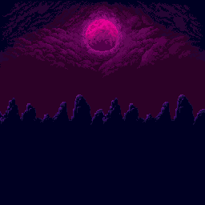
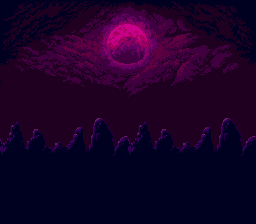

The Mega Drive ROM reproduces the project's `bg` stage (moon, clouds and
mountains) tile-for-tile. The only visible differences are the 9-bit Mega
Drive colours and the missing layers/sprites that the project renders in
custom code.

**Sonic 2 disassembly (Mega Drive) → SNES**

```text
source:  sgdk-test-projects/s2disasm
mode:    megadrive_snes
import:  level/layout/EHZ_1.kos, mappings/128x128/EHZ_HTZ.kos,
         mappings/16x16/EHZ.kos, art/kosinski/EHZ_HTZ.kos,
         art/palettes/EHZ.bin (Kosinski decompression in GDScript)
stage:   Emerald Hill Zone Act 1, crop 32x28 tiles at (0,69)
ROM:     524,288 bytes (512 KiB), LoROM FastROM, checksum OK
build:   exit 0, 0 errors
validate_rom: sd2snes_ready=true
preview: frame 120, 256x224
```

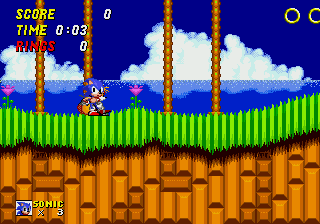
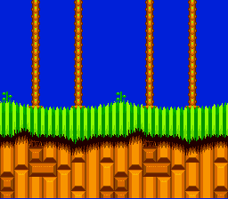

The exported SNES stage uses the original 914 Emerald Hill tiles, the original
chunk/block layout and palette lines 1-3 (palette line 0 is the backdrop). The
geometry, palm trees, grass and checkerboard dirt match the original; the
sprite layer (Sonic/Tails/HUD), parallax background, rings, objects and
gameplay are not part of the stage export.

**Bugs fixed while running these tests**

- SGDK `res/audio.rs` collision: a BGM and an SFX both named `baroque` emitted
  the same symbol. The audio pipeline now converts only the first BGM and
  assigns unique `bgm_`/`sfx_` names.
- PVSnesLib `816-tcc` emitted a single `.db` line larger than 100 KiB for the
  914-tile tileset and the BRR samples; WLA rejected the truncated fragment.
  Large SNES assets are now written as binary files and included by
  `src/assets_data.asm` / `src/sfx_data.asm` (`.incbin`), with only the sizes
  declared in C. This also applies to the splash, map and palette.
- Sonic 2 projects had no `RetroStage`, so the MD→SNES mode failed with
  `no stage/image asset available for conversion`. A Sonic 2 disassembly stage
  importer (Kosinski + chunk/block/tile/palette decoding) was added.

**Fidelity boundary**

The cross-platform modes export a stage (tile set, palette, map and, when
available, a player sprite). They do not translate game logic, physics,
scripts, HUD, parallax layers, enemies, object lists or music sequencing.
"Nothing different except colours and BGM" is therefore not achievable for a
complete game with this pipeline; it is achieved for the exported stage data:

- colours: Mega Drive 9-bit → SNES 15-bit, palette indices preserved;
- BGM: the generated project uses one converted BGM/SFX set, not the original
  sound driver.
- Gothicvania's real level is a custom two-layer 600x28-tile page streamer; only
  its `bg` stage is exposed as a `RetroStage`, so that is what gets exported.
- Sonic 2's foreground level is imported from the original Kosinski data; the
  parallax background, sprites, HUD and SMPS music remain project-specific.

### Sonic 2 → SNES engine port — first playable slice (experimental)

A first vertical slice of the Sonic 2 engine was reimplemented in C for
PVSnesLib and verified in the ROM preview. It is a source-level reimplementation
of the core, not a binary translation.

```text
generator: tools/sonic2_snes_port.py
ROM:       524,288 bytes, LoROM FastROM
build:     exit 0
preview:   walk at frame 90, jump at frame 135, land at frame 260
```

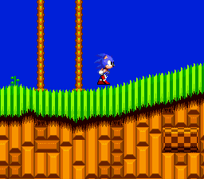
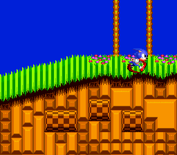
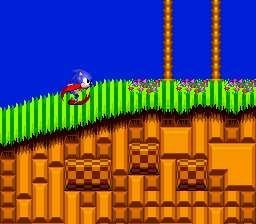

Implemented: original EHZ Act 1 tiles/map/palette for a 64x64-tile slice,
original collision indexes/heightmaps, camera scrolling, ground
acceleration/deceleration/top speed, jump, gravity, air control, floor/ceiling
heightmap collision while airborne, and idle/walk/run/roll animations from the
original Sonic sprite sheet.

Not yet implemented: slope following (`AnglePos` still disabled after an
816-tcc stack/ABI freeze), walls, full-level streaming, rings, objects,
badniks, HUD, sound, Tails and special stages. See
`docs/SONIC2_SNES_PORT.md` for the full list and implementation notes.

The preview's injected controller events were unreliable in headless mode, so
the evidence build (`--demo`) forces right and one jump. The normal generator
output uses `padsCurrent(0)` for real input.

### Mega Drive → SNES port registry and native runtime translation (0.1.39)

The `megadrive_snes` Game Build mode now runs a source-format registry
(`md_to_snes_port.gd`) before the stage viewer.

**Native Mega Drive project (engine-generated) → SNES**

```text
source:    large_ssf2 native project (32x28 stage, 1 actor, 1 widget, 1 solid)
export:    megadrive_snes
ROM:       262,144 bytes, LoROM, checksum OK
runtime:   actors=1 widgets=1 solids=1
preview:   SCORE/START UI and runtime frame visible
```

The native path finds the bundle in `metadata.native_port`, loads the stage
from the bundle, resolves actor assets against the bundle source root, and
reuses the shared SNES runtime generator (states, animations, solids, widgets,
input, camera). This is the general path for projects authored in the engine's
portable format.

**Sonic 2 disassembly → SNES through Game Build**

```text
GEN handled=true ok=true
BUILD ok=true exit=0
ROM:       524,288 bytes, LoROM FastROM, checksum OK
runtime:   Sonic 2 EHZ source adapter
preview:   walk at frame 90, jump at 135, landing at 260 (--demo)
```

**Unsupported raw 68000 projects**

The registry returns an explicit error explaining that a faithful port needs a
per-game source adapter; it no longer silently emits a stage viewer as a
"port". See `docs/MD_TO_SNES_PORTING.md`.

Remaining Sonic 2 adapter work (slopes/ground snap, walls, full-level
streaming, rings, objects, HUD, audio) is tracked in `docs/SONIC2_SNES_PORT.md`.

### Sonic 2 full-level BG page streaming (0.1.40)

The Sonic 2 adapter now exports the **full EHZ Act 1** heightmap window instead
of a 512x512 slice:

```text
level bounds:  10,656 x 1,024 px (LevelSize x 0..$29A0, y 0..$320 + view)
BG window:     64x64 tiles, 42x4 source pages, 8 pages per 16 KiB ROM group
ROM:           524,288 bytes, LoROM FastROM, checksum OK (77 KiB free)
BG tiles:      634 used tiles
collision:     full layout + 32 KiB chunk map + 16x16 blocks + heightmaps
```

The generated build and the Game Build `Mega Drive -> SNES` path both produce
the same 512 KiB ROM. The demo traverses the start, a pit, and the fall reset:

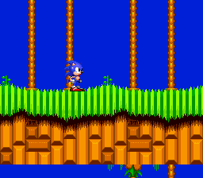
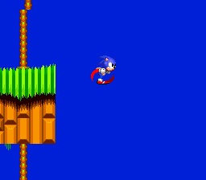
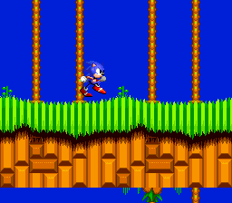

Also enabled in this pass: terrain Y snap with the original heightmap/step
logic and `FindWall`/`FindWall2` walls on the start terrain. Still pending:
slope velocity rotation/loops, rings/objects/HUD, death animation, audio,
Tails and special stages.

### Sonic 2 rings and HUD (0.1.41)

The adapter now imports the compressed Act 1 ring list, expands it to 226
rings, and renders/collects them with the original ring sprite frames. A
SCORE/TIME/RINGS HUD is drawn as 8x8 OBJ glyphs from a compact 5x7 font.

```text
ring list:  level/rings/EHZ_1.bin -> 226 rings (row/column RLE expanded)
ring art:   common_ring.png, 4 frames, palette 1
HUD:        SCORE/TIME/RINGS at OBJ tile 348..386, palette 2
ROM:        524,288 bytes, LoROM FastROM, checksum OK
```

Verified in the engine build and in a short collection test:

```text
SCORE 000010
RINGS 001
```

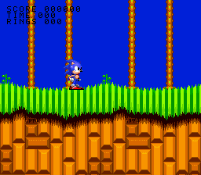
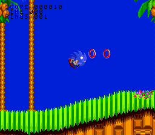

The HUD layout matches Sonic 2; the original HUD art/font, ring sound, objects,
slopes/loops, death/lives, audio and openings/ending remain pending.

### Sonic 2 objects (0.1.42)

The adapter now imports the EHZ Act 1 object list and renders the original
spring, monitor, star post and goal signpost art from the Nemesis files with
their original sprite mappings. Objects use a BG2 screen-space layer (palette
7, priority above the level); OBJ tiles moved to VRAM 0x6000 so the object CHR
fits at 0x4000.

```text
level/objects/EHZ_1.bin -> 31 interactive objects:
                           13 monitors, 14 springs, 3 star posts, 1 signpost
art/nemesis/Monitor and contents.nem
art/nemesis/Star pole.nem
art/nemesis/Signpost.nem
art/nemesis/{Vertical,Horizontal,Diagonal} spring.nem
                        -> 194 deduplicated 8x8 tiles (6,240 bytes)
level width              -> 1,376 tiles / 11,008 px (goal signpost at 10,816)
BG pages                 -> 43 x 4 = 172 pages, 22 groups
ROM                      -> 524,288 bytes, LoROM FastROM, checksum OK
free ROM                 -> 51,409 bytes
```

Interactions verified from controlled start positions:

- monitor: solid top, spin-jump break, broken frame, power-up contents;
- spring: vertical launch with the original strength and bounce animation;
- star post: proximity activation, checkpoint saved, star ball removed;
- goal signpost: idle Eggman face, spin to the Sonic face, HUD timer stopped.

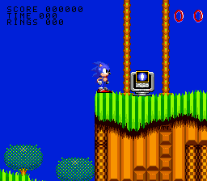
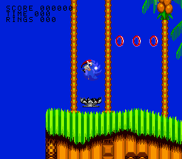
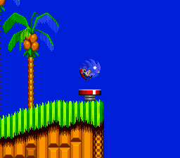
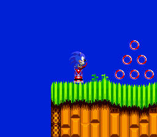
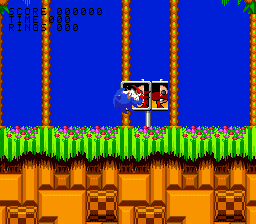

Badniks, spikes, bridges/platforms, hurt/death/lives and audio remain.

### Sonic 2 badniks, spikes and hurt/death (0.1.43)

The adapter now imports the remaining EHZ Act 1 gameplay objects and adds the
damage/death loop. The object list has 75 supported entries:

```text
13 monitors, 14 springs, 3 star posts, 1 goal signpost,
12 spike sets, 11 Buzz Bombers, 13 Mashers, 8 Coconuts

art/nemesis/{Buzzer enemy,EHZ Pirahna badnik,Coconuts badnik from EHZ,Spikes}.nem
mappings obj36/obj4B/obj5C/obj9D -> original spike/badnik frames
Sonic frames 0x4E (hurt) and 0x5C (death) -> 18 total frames, 384 OBJ tiles
rings 32 + HUD 39 tiles -> 455 / 512 OBJ tiles
BG2 object atlas -> 272 of 512 CHR tiles
ROM -> 524,288 bytes, LoROM FastROM, checksum OK, 41,423 bytes free
```

Verified from controlled start positions:

- Buzz Bomber hovering/bobbing with the original two body frames;
- ceiling and floor spikes with the original y-flip orientation;
- spike contact triggering hurt with ring scatter (lost rings drawn and
  collectible after a delay);
- spike contact with zero rings triggering the death pose and fall;
- checkpoint respawn at the start after death, with the act timer and rings
  reset;
- stomping a Coconuts: badnik removed, score +100 and Sonic bounces.

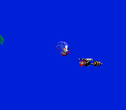
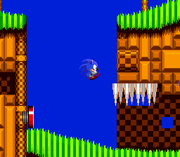
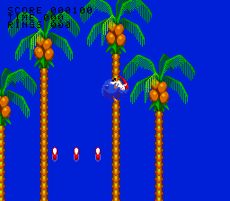
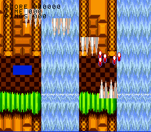
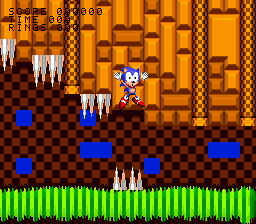
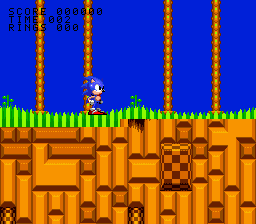

Badnik projectiles, the game-over screen, lives HUD, explosions and audio
remain.

### Sonic 2 effects, lives and spin dash (0.1.44)

The object/effect pass adds the remaining EHZ gameplay feedback that was still
missing from the port:

```text
Buzzer fireball / Coconuts projectile -> original projectile frames, collision
badnik stomp                          -> original explosion frames + score +100
shield / invincibility                -> original Shield/Invincibility stars art
1-up monitor                          -> monitor casing + Sonic lives-counter head
lives HUD                             -> SONIC + digit at the bottom-left
GAME OVER                             -> text screen, automatic restart after 180 loops
Masher                                -> original jump/gravity water cycle
spin dash                             -> down + jump charge, release down to launch
```

Build and validation:

```text
ROM     -> 524,288 bytes, LoROM FastROM, checksum OK, 30,440 bytes free
OBJ     -> 455 / 512 tiles (Sonic 18 frames + rings + HUD)
BG2 CHR -> 380 / 512 tiles (monitors, spikes, badniks, shield, stars, explosion)
RAM     -> ~135 KB free
```

Controlled checks: Buzzer fireball, explosion on stomp, shield orb,
invincibility stars, 1-up monitor face, SONIC lives counter, GAME OVER and
restart, Masher water jumps and spin dash launch.

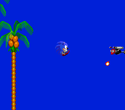
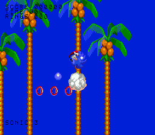
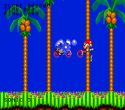
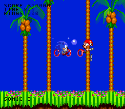
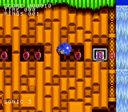
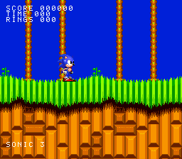
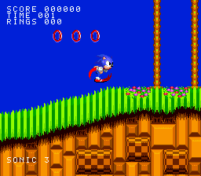
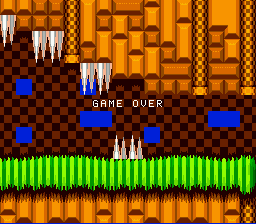

Still pending: original SMPS audio, slopes/loops, bridges/platforms/scenery,
the original HUD font/title card, Tails, special stages, two-player mode,
openings and ending.

### Sonic 2 bridges, platforms and SNES SFX (0.1.45)

This pass adds the remaining static traversal objects, a first SNES sound
implementation and a larger ROM for future modes:

```text
bridges       -> 7 EHZ bridge objects, original logs, level palette line 2,
                 solid tops
platforms     -> 7 EHZPlatform objects, original level-art mappings, solid tops
audio         -> ring, spring, jump, hurt, monitor and signpost BRR SFX
                 (PVSnesLib sound engine; synthesized placeholders)
ROM           -> 1,048,576 bytes, LoROM FastROM, checksum OK
free ROM      -> 529,708 bytes
OBJ           -> 455 / 512 tiles
BG2 CHR       -> 402 / 512 tiles
```

The audio generator uses `tools/retro_audio_tool.py` + `snesbrr`; if either
tool is missing the port still builds with `SFX_ENABLED=0`.

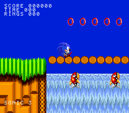
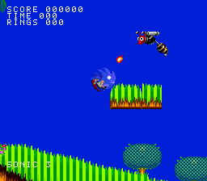

Still pending: original SMPS music/DAC, slopes/loops, moving platforms/scenery,
title/act cards, Tails, special stages, two-player mode, openings/ending.

### Sonic 2 corkscrew/spiral path (0.1.46)

The EHZ corkscrew objects (`Obj06`, id 6) are now imported. Their original
`Obj06_CosineTable` and `Obj06_FlipAngleTable` drive Sonic's Y position along
the spiral, and OAM priority switches him behind the loop art on the far side.
The path uses the roll animation because the SNES port does not yet import the
full 360-degree tumble frame set.

```text
objects: 92 total (3 spirals imported)
ROM:     1,048,576 bytes, LoROM FastROM, checksum OK
free:    528,653 bytes
preview: spiral entry at x=4,800; Sonic follows the corkscrew and moves behind
         the checkered loop art
```

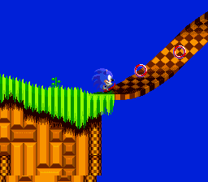
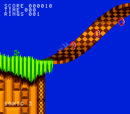

The remaining big blocks are SMPS music, full vertical-loop/plane-switcher
coverage, slopes, Tails/specials/two-player, title/act cards and ending.

### Sonic 2 Tails follower (0.1.47)

Five original Tails frames (idle, two walk, two fly) are imported into the BG2
object atlas. Tails follows a 32-entry Sonic position history with a 10-frame
delay, uses walk frames while moving, fly frames when he falls behind, and
resets his history on respawn. This is a visual sidekick, not the complete
Tails AI/two-player logic.

```text
OBJ/BG2: 474 / 512 CHR tiles (Sonic, objects, effects, Tails)
ROM:     1,048,576 bytes, LoROM FastROM, checksum OK
free:    524,773 bytes
```

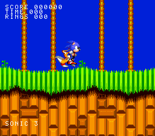

Remaining: full Tails/2P AI, SMPS music, full vertical loops/plane switching,
special stages, water, title/act cards, openings/ending.

### Sonic 2 corkscrew tumble poses (0.1.48)

Three original Sonic tumble/rotation poses are imported into the BG2 atlas and
selected from the spiral flip angle. The OBJ Sonic is hidden while on the
spiral, and the BG2 tumble sprite changes priority to disappear behind the loop
art on the far side. Only 3 of the 12 tumble poses fit the 512-tile BG2 budget;
the intermediate poses remain.

```text
BG2 CHR: 501 / 512 tiles
ROM:     1,048,576 bytes, LoROM FastROM, checksum OK
free:    523,773 bytes
```

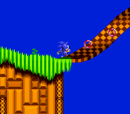

Still pending: SMPS music, full vertical loops/plane switching, full Tails/2P,
special stages, water, title/act cards, openings/ending, and the remaining
tumble poses.
